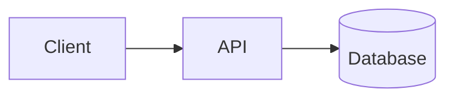
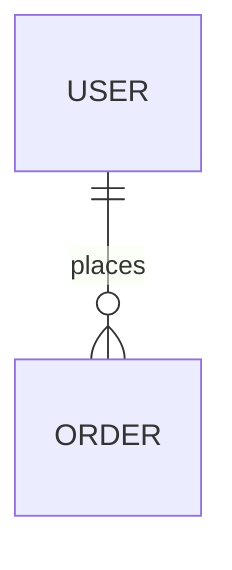

# Thiết kế kiến trúc - <Tên dự án>

## 1. Kiểu kiến trúc & lý do chọn
## 2. Công nghệ sử dụng
## 3. Sơ đồ kiến trúc tổng thể

## 4. Danh sách module
## 5. Mô hình dữ liệu

## 6. Thiết kế API
## 7. Luồng chính (sequence)
## 8. Cấu trúc thư mục
## 9. Quyết định kiến trúc (ADR)
## 10. Các cân nhắc bảo mật & khả năng test
