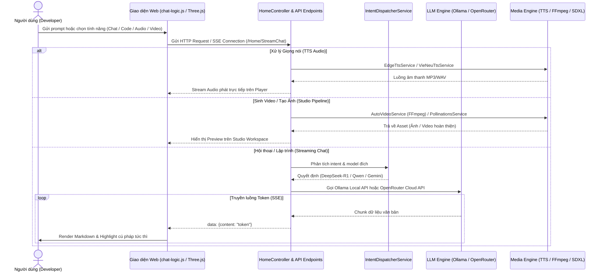

# COW-AI — Nền Tảng Trợ Lý Trí Tuệ Nhân Tạo Đa Mô Hình (Multi-Model AI Platform)

<p align="center">
  
</p>

**COW-AI** là hệ thống trợ lý AI đa mô hình được xây dựng trên nền tảng **ASP.NET Core MVC (.NET 10)**, thiết kế theo tôn chỉ **Local-First, Developer-Centric và Bảo mật tối đa**. Ứng dụng tích hợp sâu giữa các mô hình AI cục bộ (Ollama) và đám mây (OpenRouter), hệ thống tổng hợp giọng nói tiếng Việt chuẩn tự nhiên (Edge TTS & VieNeu-TTS), sinh ảnh và tự động hóa biên tập video chuyên nghiệp (Studio Auto-Video).

---

## 🚀 Tính Năng Cốt Lõi

### 1. Điều Phối Mô Hình Thông Minh (Intelligent Omni-Routing)
- **Local LLMs qua Ollama**: Tối ưu chạy trực tiếp trên GPU máy cá nhân (NVIDIA GeForce RTX 4060, VRAM offload 100%). Hỗ trợ các mô hình:
  - `deepseek-r1:latest` (Bản 7B reasoning siêu tốc cho lập trình, logic, suy luận sâu)
  - `qwen2.5:7b` & `qwen2.5-coder:7b` (Codebase intelligence & hội thoại)
  - `cow-ai:latest` (Mô hình tùy biến riêng)
- **Cloud LLMs qua OpenRouter**: Kết nối linh hoạt tới Gemini 2.0 Flash, DeepSeek-R1 Cloud, Llama 3 8B.
- **Tự động định tuyến (Zero-prompt overhead)**: Nhận diện ngữ cảnh để tự động chọn mô hình phù hợp nhất (lập trình, giải toán, tóm tắt hoặc đàm thoại chung).

### 2. Giao Tiếp Thời Gian Thực & Trải Nghiệm Lập Trình Viên Đỉnh Cao
- **Server-Sent Events (SSE)**: Truyền tải luồng token phản hồi tức thì (<400ms theo chuẩn Doherty Threshold).
- **Code Highlighting & Markdown**: Trình bày code đa ngôn ngữ chuẩn xác với Prism.js và bộ phông lập trình viên (Fira Code, JetBrains Mono).
- **Three.js 60 FPS Background**: Không gian làm việc hiện đại, trực quan, chuyển đổi mượt mà giữa chế độ Hero tập trung và Bottom-docked chat.

### 3. Âm Thanh & Giọng Đọc Tiếng Việt Đỉnh Cao (Dual-Engine TTS)
- **Microsoft Edge Neural TTS**: Giọng đọc tự nhiên chất lượng cao (`vi-VN-HoaiMyNeural`, `vi-VN-NamMinhNeural`).
- **VieNeu-TTS (Local AI Voice)**: Tích hợp mô hình giọng đọc cục bộ tiếng Việt (`Hải Đăng`, `Lan Nhi`, `Bình`) chạy qua môi trường Python nội bộ.

### 4. Studio Auto-Video & Sinh Ảnh Nghệ Thuật
- **Pollinations & SDXL Turbo Local**: Sinh ảnh tức thì từ prompt tự nhiên.
- **Pipeline Auto-Video**: Biên tập video so sánh, tự động ghép slide thuyết trình, âm thanh BGM, lồng tiếng TTS và render qua FFmpeg chất lượng cao (1080p@30fps).

### 5. Cơ Sở Dữ Liệu & Lưu Trữ Dự Án
- Tích hợp **PostgreSQL** kết hợp **Entity Framework Core (`net10.0`)**, quản lý an toàn phiên làm việc, dự án video và cấu hình hệ thống.

---

## 🏗️ Sơ Đồ Kiến Trúc & Luồng Xử Lý



---

## 💻 Yêu Cầu Hệ Thống & Cài Đặt

### 1. Yêu cầu tiên quyết
- **Hệ điều hành**: Windows 10/11 x64 hoặc Linux.
- **.NET SDK**: Phiên bản **.NET 10.0** trở lên.
- **Card đồ họa (Khuyến nghị cho Local AI)**: NVIDIA GeForce RTX (VRAM từ 6GB–8GB trở lên để chạy full GPU offload cho DeepSeek-R1 7B).
- **Ollama**: Đã cài đặt [Ollama](https://ollama.com/) trên máy.
- **PostgreSQL**: Phiên bản 14 trở lên đang chạy tại `localhost:5432`.
- **FFmpeg & Python (Tùy chọn)**: Nếu sử dụng module VieNeu-TTS và Auto-Video.

---

## ⚙️ Hướng Dẫn Cấu Hình (Bảo Mật)

> [!IMPORTANT]
> **Quy tắc bảo mật quan trọng:** Tuyệt đối không commit các file `appsettings.json`, `appsettings.Development.json`, `.env` hoặc các tệp logs/workspace cá nhân lên Git.

1. **Khởi tạo tệp cấu hình từ mẫu:**
   ```powershell
   Copy-Item appsettings.example.json appsettings.json
   ```

2. **Cập nhật các thông số trong `appsettings.json`:**
   - **PostgreSQL**: Cập nhật `ConnectionStrings:PostgreSql` với username và password cơ sở dữ liệu của bạn.
   - **Ollama**: Kiểm tra cấu hình `FallbackLocalUrl` (`http://localhost:11434/v1`) và danh sách models.
   - **Đường dẫn thư viện**: Nếu sử dụng AutoVideo và VieNeu, cập nhật lại đường dẫn `FfmpegPath` và `RepoPath`.

3. **Cài đặt DeepSeek-R1 về máy qua Ollama:**
   ```powershell
   ollama pull deepseek-r1
   # Chạy kiểm tra trực tiếp
   ollama run deepseek-r1
   ```

---

## 🛠️ Vận Hành & Khởi Chạy

### 1. Khởi chạy ứng dụng
Mở terminal tại thư mục gốc của dự án (`d:\COW-AI`):
```powershell
dotnet run
```
Truy cập ứng dụng tại: **`http://localhost:5223`**

### 2. Dừng server an toàn
- Nhấn `Ctrl + C` tại cửa sổ terminal đang chạy.
- Nếu cổng `5223` bị chiếm dụng do terminal bị đóng đột ngột, giải phóng cổng bằng PowerShell:
  ```powershell
  Get-NetTCPConnection -LocalPort 5223 -State Listen -ErrorAction SilentlyContinue |
      ForEach-Object { Stop-Process -Id $_.OwningProcess -Force -ErrorAction SilentlyContinue }
  ```

### 3. Kiểm tra kết nối AI Local (Ollama)
```powershell
Invoke-RestMethod -Uri "http://localhost:11434/api/tags" -Method Get
```

---

## 🛡️ Cấu Trúc Dự Án Chuẩn

```
d:\COW-AI/
├── Controllers/            # Bộ điều hướng MVC & API endpoints (HomeController, ApiController)
├── Data/                   # Entity Framework Core DbContext (AppDbContext)
├── Models/                 # ViewModels, Request/Response DTOs & Domain Models
├── Prompts/                # Hệ thống Dynamic Prompts (Zero Hardcoded Prompts)
├── Services/               # Core Logic: OllamaService, OpenRouterService, EdgeTtsService,
│                           # AutoVideoService, VieNeuTtsService, IntentDispatcherService
├── Tools/                  # Công cụ tiện ích, MCP worker, python bridge
├── Views/                  # Giao diện người dùng Razor View & Partial Views
├── wwwroot/                # Tài nguyên tĩnh: CSS, JavaScript (chat-logic.js, bg-animation.js)
├── .gitignore              # Bộ lọc bảo mật loại trừ bí mật, binary và dữ liệu runtime
├── appsettings.example.json# Tệp cấu hình mẫu (an toàn, không chứa secret)
└── README.md               # Tài liệu hướng dẫn dự án
```

---

## 📄 Bản Quyền & Giấy Phép
Dự án được phát triển phục vụ mục đích học tập, nghiên cứu và xây dựng trợ lý AI chuyên nghiệp.
Mọi đóng góp và báo cáo lỗi xin gửi về qua mục Issues trên GitHub Repository.
