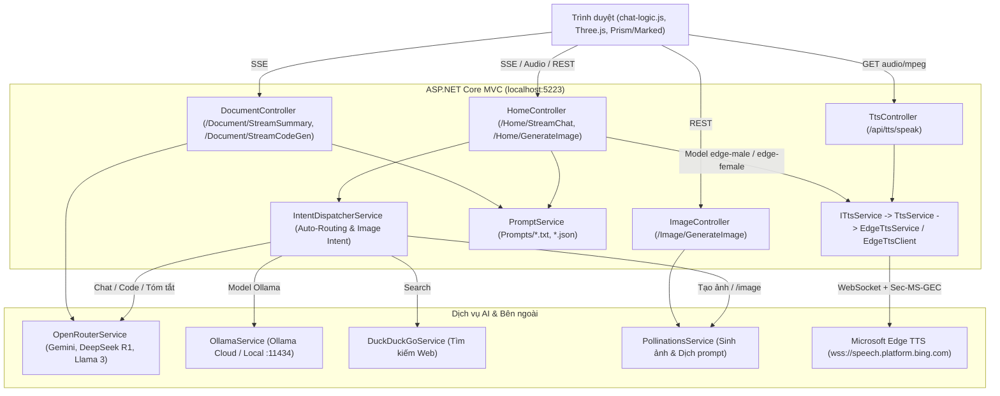
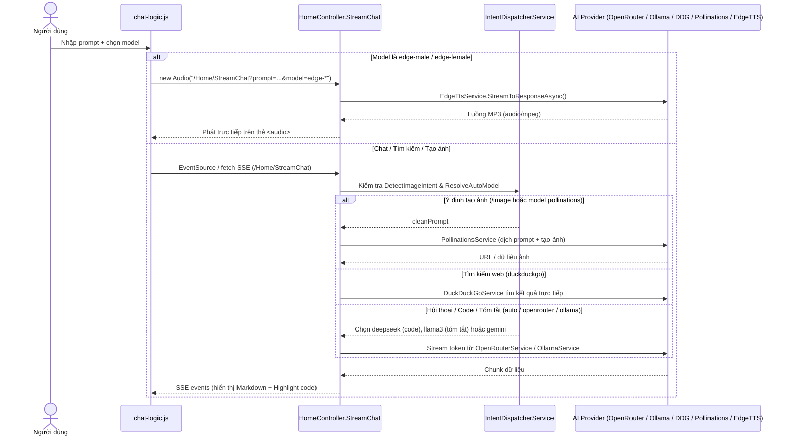

# COW-AI

Ứng dụng trợ lý AI đa mô hình xây dựng trên **ASP.NET Core MVC (`net10.0`)**, chạy mặc định tại `http://localhost:5223` (xem `Properties/launchSettings.json`). Hỗ trợ chat streaming (SSE), tự động điều phối mô hình theo ngữ cảnh, tìm kiếm web, sinh ảnh, tóm tắt/sinh mã nguồn và đọc văn bản tiếng Việt (Edge TTS).

---

## 1. Kiến trúc hệ thống & Luồng xử lý

### 1.1. Kiến trúc tổng quan



### 1.2. Luồng Chat, Auto-Routing & Streaming (SSE / TTS)



---

# Vận hành & Xử lý sự cố

## 2. Chạy / dừng server

```powershell
# Chạy server (từ thư mục D:\COW-AI)
dotnet run

# Dừng server: nhấn Ctrl + C ngay tại terminal đang chạy
```

Khi terminal bị đóng đột ngột, hoặc chạy nhiều lần `dotnet run` / `dotnet watch`
thì tiến trình cũ vẫn giữ cổng 5223. Lần chạy sau sẽ báo:

```
Failed to bind to address http://localhost:5223: address already in use.
```

Lúc này trình duyệt vẫn có thể mở được trang nhưng đang nói chuyện với **bản build cũ**,
và các API (đặc biệt là `/Home/StreamChat`, `/api/tts/speak`) trả lỗi → sinh ra
thông báo *"Không thể phát âm thanh. Vui lòng thử lại sau ít phút."*

### 1.1. Kiểm tra cổng 5223 đang bị ai giữ

```powershell
Get-NetTCPConnection -LocalPort 5223 -State Listen -ErrorAction SilentlyContinue |
    Select-Object LocalAddress, LocalPort, OwningProcess
```

Cột `OwningProcess` là PID của tiến trình đang chiếm cổng.

### 1.2. Đóng server đang chiếm cổng 5223 (khuyến nghị)

```powershell
# Lấy PID đang LISTEN trên cổng 5223 rồi kill
$owner = (Get-NetTCPConnection -LocalPort 5223 -State Listen -ErrorAction SilentlyContinue).OwningProcess
if ($owner) { Stop-Process -Id $owner -Force }
```

Hoặc dùng one-liner (không cần biết PID):

```powershell
Get-NetTCPConnection -LocalPort 5223 -State Listen -ErrorAction SilentlyContinue |
    ForEach-Object { Stop-Process -Id $_.OwningProcess -Force -ErrorAction SilentlyContinue }
```

> Lưu ý: không đặt tên biến là `$pid` — đây là biến tự động (PID của PowerShell hiện tại),
> sẽ kill nhầm shell. Dùng `$owner` như trên.

### 1.3. Đóng tất cả instance COW-AI còn sót

```powershell
# Kill mọi tiến trình app COW-AI (kể cả bản build cũ)
Get-Process -Name 'COW-AI' -ErrorAction SilentlyContinue | Stop-Process -Force

# Chỉ kill các tiến trình dotnet thuộc project này (an toàn hơn kill toàn bộ dotnet)
Get-CimInstance Win32_Process -Filter "Name='dotnet.exe'" |
    Where-Object { $_.CommandLine -like '*COW-AI*' } |
    ForEach-Object { Stop-Process -Id $_.ProcessId -Force -ErrorAction SilentlyContinue }
```

Tránh chạy `Get-Process dotnet | Stop-Process -Force` vì sẽ tắt cả các ứng dụng .NET khác
đang mở trên máy (Visual Studio, các project khác, ...).

### 1.4. Xác nhận cổng đã được giải phóng

```powershell
Get-NetTCPConnection -LocalPort 5223 -State Listen -ErrorAction SilentlyContinue
```

Không có kết quả trả về = cổng đã trống, chạy lại `dotnet run` bình thường.

### 1.5. Chạy thêm một instance ở cổng khác (không cần kill bản đang chạy)

```powershell
dotnet run --urls "http://localhost:5224"
```

### 1.6. Kiểm tra nhanh server còn sống

```powershell
Invoke-WebRequest "http://localhost:5223/" -UseBasicParsing -TimeoutSec 10 | Select-Object StatusCode
```

---

## 3. Lỗi "Không thể phát âm thanh. Vui lòng thử lại sau ít phút."

Chuỗi thông báo này nằm ở `wwwroot/js/chat-logic.js` (hàm `handleTtsError`, dòng ~419-447).
Nó là thông báo **chung**, hiển thị cho mọi lỗi của thẻ `<audio>`, gồm cả lỗi phía server
lẫn lỗi phía trình duyệt. Vì vậy cần xem nguyên nhân thật trong log server.

### 2.1. Luồng xử lý

1. Người dùng chọn model `edge-male` / `edge-female`
   → `chat-logic.js` tạo `new Audio('/Home/StreamChat?prompt=...&model=edge-female')`.
2. `HomeController.StreamChat` gọi `EdgeTtsService.StreamToResponseAsync`
   → `EdgeTtsClient` mở WebSocket tới `wss://speech.platform.bing.com` để tổng hợp giọng nói.
3. Nếu bước 2 ném exception, `HomeController` trả **HTTP 500** kèm JSON
   `{"error":"Không thể tạo âm thanh. Vui lòng thử lại sau ít phút."}`.
4. Thẻ `<audio>` nhận response không phải MP3 → kích hoạt `audio.onerror`
   → hiển thị *"Không thể phát âm thanh. Vui lòng thử lại sau ít phút."*

### 2.2. Các nguyên nhân thường gặp

| # | Nguyên nhân | Chi tiết |
|---|---|---|
| 1 | **Token `Sec-MS-GEC` hết hiệu lực / sai** | `EdgeTtsDrm.GenerateSecMsGec()` sinh token từ **đồng hồ hệ thống** (làm tròn 5 phút) + `ChromiumFullVersion = "143.0.3650.75"` hard-code trong `EdgeTtsClient.cs`. Đồng hồ lệch > 5 phút, hoặc Microsoft đổi phiên bản/DRM → WebSocket trả **403** → server 500. |
| 2 | **Microsoft rate-limit / chặn IP** | Gửi quá nhiều request trong thời gian ngắn, dùng VPN/proxy, hoặc IP bị đánh dấu → **403/429**. Đây là lý do thông báo khuyên "thử lại sau ít phút". |
| 3 | **Không nhận được frame audio** | `EdgeTtsClient.StreamAsync` ném `InvalidOperationException("Edge TTS không trả về dữ liệu âm thanh...")` khi hết stream mà `audioReceived == false` (câu quá ngắn, toàn ký tự bị lọc, SSML lỗi). |
| 4 | **Mạng / DNS / firewall / proxy** | Không kết nối được `wss://speech.platform.bing.com:443` → `WebSocketException` tại `ConnectAsync`. |
| 5 | **Cổng 5223 bị instance cũ chiếm** | Request audio đi vào bản build cũ/không đúng tiến trình, hoặc server đã bị kill giữa lúc phát → `audio.onerror` (xem mục 1). |
| 6 | **Lỗi giữa luồng (response đã bắt đầu)** | Edge TTS đứt khi header `audio/mpeg` đã gửi đi; server không thể đổi sang 500 nên trình duyệt nhận file MP3 bị cắt → lỗi giải mã. |
| 7 | **`play()` bị reject (phía trình duyệt)** | `audio.play().catch(handleTtsError)` bắt **mọi** rejection, kể cả `AbortError` khi `stopSpeaking()` pause audio (gửi tin nhắn mới, bấm loa khác) hoặc chính sách autoplay. Trường hợp này server hoàn toàn bình thường nhưng vẫn hiện thông báo lỗi. |
| 8 | **URL audio trả về không phải audio** | Route 404 sau khi rebuild, trang HTML lỗi, hoặc redirect HTTPS (`UseHttpsRedirection`) → `<audio>` không giải mã được. |

### 2.3. Cách xác định nguyên nhân thật

Xem log server (terminal chạy `dotnet run`) — tìm dòng:

```
Lỗi Edge TTS cho prompt '...' với voice '...'
```

Stack trace đi kèm cho biết chính xác là 403 (token/rate-limit), timeout mạng,
hay `InvalidOperationException` (không có audio).

Kiểm tra trực tiếp endpoint TTS (không qua trình duyệt):

```powershell
# Phải trả về Content-Type: audio/mpeg và file > 0 byte
Invoke-WebRequest "http://localhost:5223/api/tts/speak?text=Xin%20ch%C3%A0o&voice=vi-VN-HoaiMyNeural" `
    -OutFile "$env:TEMP\tts-test.mp3" -UseBasicParsing -TimeoutSec 30
Get-Item "$env:TEMP\tts-test.mp3" | Select-Object Length
```

- Trả về **200 + file MP3** → server OK, lỗi nằm ở trình duyệt/cổng/kết nối.
- Trả về **500** → Edge TTS phía Microsoft hoặc mạng.
- **Connection refused** → server chưa chạy hoặc đang tranh cổng 5223.

Đồng bộ lại đồng hồ Windows nếu nghi ngờ lệch giờ (nguyên nhân #1):

```powershell
w32tm /resync
```

### 2.4. Cách khắc phục nhanh

1. `Ctrl + C` terminal cũ, kill sạch instance đang giữ cổng 5223 (mục 1.2 / 1.3), rồi `dotnet run` lại.
2. Kiểm tra endpoint TTS bằng lệnh ở mục 2.3.
3. Nếu vẫn 403/429: chờ vài phút, tắt VPN/proxy, đổi mạng, và kiểm tra lại đồng hồ hệ thống.
4. Nếu Microsoft đã đổi DRM: cập nhật `ChromiumFullVersion` / thuật toán `Sec-MS-GEC` trong
   `Services/EdgeTtsClient.cs` và `Services/EdgeTtsDrm.cs`.
