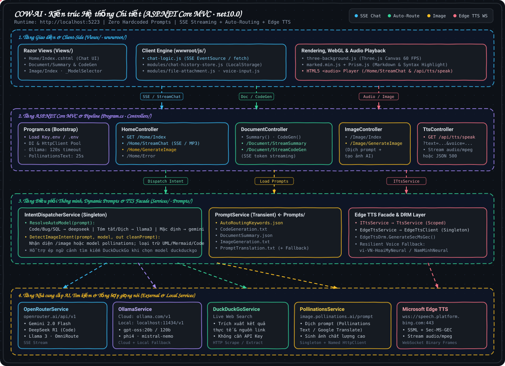
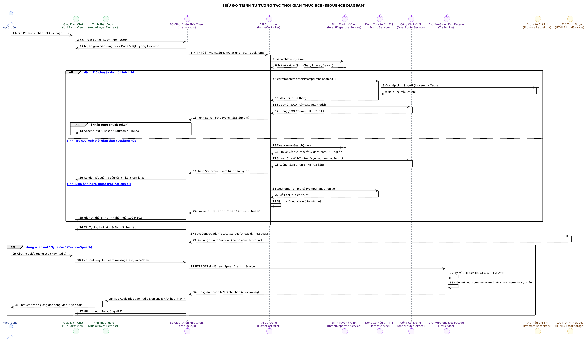

<div align="center">

  

  # COW.AI
  ### The Autonomous Multi-Model AI Operating System
  *Nền tảng Trợ lý Trí tuệ Nhân tạo Đa Mô hình Cục bộ & Đám mây — Local-First, Developer-Centric, Tối ưu hóa GPU NVIDIA RTX & Tiếng Việt Chuẩn mực.*

  <p align="center">
    <a href="https://dotnet.microsoft.com/download/dotnet/10.0"></a>
    <a href="https://learn.microsoft.com/dotnet/csharp/"></a>
    <a href="https://ollama.com/"></a>
    <a href="https://www.deepseek.com/"></a>
    <a href="https://www.postgresql.org/"></a>
    <a href="https://www.nvidia.com/"></a>
    
    
    
  </p>

  <p align="center">
    <a href="#-1-tổng-quan--triết-lý-thiết-kế">Triết lý thiết kế</a> •
    <a href="#-2-ma-trận-tính-năng--các-mô-hình-ai">Ma trận tính năng</a> •
    <a href="#-3-kiến-trúc-hệ-thống--sơ-đồ-luồng">Kiến trúc hệ thống</a> •
    <a href="#-4-yêu-cầu-hệ-thống--phần-cứng">Yêu cầu phần cứng</a> •
    <a href="#-5-hướng-dẫn-cài-đặt-nhanh">Bắt đầu nhanh</a> •
    <a href="#-6-thiết-lập-ai-cục-bộ-ollama">Thiết lập Ollama</a> •
    <a href="#-10-cẩm-nang-vận-hành--xử-lý-sự-cố">Xử lý sự cố</a> •
    <a href="#-11-chính-sách-bảo-mật">Chính sách bảo mật</a>
  </p>

</div>

---

## 📑 Mục Lục
- [1. Tổng Quan & Triết Lý Thiết Kế](#-1-tổng-quan--triết-lý-thiết-kế)
- [2. Ma Trận Tính Năng & Các Mô Hình AI](#-2-ma-trận-tính-năng--các-mô-hình-ai)
- [3. Kiến Trúc Hệ Thống & Sơ Đồ Luồng](#-3-kiến-trúc-hệ-thống--sơ-đồ-luồng)
- [4. Yêu Cầu Hệ Thống & Phần Cứng Khuyến Nghị](#-4-yêu-cầu-hệ-thống--phần-cứng-khuyến-nghị)
- [5. Hướng Dẫn Cài Đặt Nhanh (Quick Start)](#-5-hướng-dẫn-cài-đặt-nhanh-quick-start)
- [6. Thiết Lập AI Cục Bộ (Ollama & DeepSeek-R1)](#-6-thiết-lập-ai-cục-bộ-ollama--deepseek-r1)
- [7. Cấu Trúc Thư Mục Dự Án](#-7-cấu-trúc-thư-mục-dự-án)
- [8. Giao Thức Truyền Dữ Liệu & API Reference](#-8-giao-thức-truyền-dữ-liệu--api-reference)
- [9. Hệ Thống Studio Biên Tập Video Tự Động (Auto-Video)](#-9-hệ-thống-studio-biên-tập-video-tự-động-auto-video)
- [10. Cẩm Nang Vận Hành & Xử Lý Sự Cố (Troubleshooting)](#-10-cẩm-nang-vận-hành--xử-lý-sự-cố-troubleshooting)
- [11. Chính Sách Bảo Mật & An Toàn Môi Trường](#-11-chính-sách-bảo-mật--an-toàn-môi-trường)
- [12. Đóng Góp & Giấy Phép](#-12-đóng-góp--giấy-phép)

---

## 💎 1. Tổng Quan & Triết Lý Thiết Kế

**COW.AI** là giải pháp trợ lý số toàn diện xây dựng trên nền tảng **ASP.NET Core MVC (`net10.0`)**, kết hợp kỹ thuật công thái học nhận thức (**Cognitive Ergonomics**) và ngôn ngữ mỹ thuật hiện đại:

* **Triết lý "Cybernetic Glass" (Thủy Tinh Điều Hợp):** Giao diện thiết kế theo hệ màu tương phản cao (Nền Obsidian `#0b0f19`, điểm nhấn Cyan & Indigo), bề mặt bán trong suốt Frosted Glassmorphism, khoảng cách Bento Box khoa học, tối ưu hóa công năng cho kỹ sư phần mềm.
* **Tôn chỉ "Local-First & Zero Secret Leaks":** Dữ liệu hội thoại, mã nguồn, tệp tin nội bộ và tác vụ tính toán được xử lý cục bộ trên phần cứng máy trạm thông qua **Ollama** và **VieNeu-TTS**. Tuyệt đối không gửi dữ liệu nhạy cảm ra đám mây khi chạy chế độ Local.
* **Chuẩn mực công thái học nhận thức:**
  - **Doherty Threshold (<400ms):** Phản hồi luồng SSE token đầu tiên tức thì, giảm tải nhận thức và thời gian chờ đợi.
  - **WCAG 2.2 AA Compliance:** Tỷ lệ tương phản chữ tối thiểu 4.5:1, hỗ trợ phím tắt điều hướng `Tab`, `:focus-visible` sắc nét.
  - **Three.js 60 FPS Ambient Canvas:** Nền không gian chuyển động nhẹ nhàng, tự động điều tiết tài nguyên GPU khi render đồ họa nặng.

---

## ⚡ 2. Ma Trận Tính Năng & Các Mô Hình AI

Hệ thống tích hợp bộ định tuyến thông minh (**Intent Dispatcher**) tự động điều phối tác vụ đến các mô hình chuyên biệt:

| Tác Vụ Cốt Lõi | Mô Hình Khuyến Nghị | Chế Độ Thực Thi | Ưu Thế Vượt Trội |
| :--- | :--- | :--- | :--- |
| **Suy luận logic, giải thuật & toán học** | `deepseek-r1:latest` (7B Distill) | **Ollama Local (GPU)** | Chuỗi suy nghĩ sâu (`<think>`), bóc tách bài toán phức tạp, giải thuật C#/.NET tối ưu. |
| **Kỹ nghệ mã nguồn & Định dạng Markdown** | `cow-ai:latest` / `qwen2.5-coder:7b` | **Ollama Local (GPU)** | Sinh code sạch, kiến trúc chuẩn MVC, trích xuất cấu trúc Markdown không bị sai lệch. |
| **Biên kịch Video & Quản lý nhịp điệu** | `qwen2.5:7b` (General) | **Ollama Local (GPU)** | Văn phong tiếng Việt mượt mà, phân bổ thời lượng khớp chuẩn từng giây cho video phân cảnh. |
| **Tổng hợp giọng nói tiếng Việt Studio** | `VieNeu-TTS` (Hải Đăng, Lan Nhi, Bình) | **Local Python Service** | Giọng đọc AI tự nhiên chất lượng cao 48kHz, không phụ thuộc kết nối Internet. |
| **Giọng nói thần kinh Cloud** | `Edge Neural TTS` (Hoài My, Nam Minh) | **Microsoft Edge Cloud** | Độ trễ cực thấp, giọng truyền cảm, hỗ trợ nghe trực tiếp trên trình duyệt. |
| **Hội thoại tổng quát & Tóm tắt diện rộng** | `google/gemini-2.0-flash-exp` | **OpenRouter Cloud** | Tốc độ siêu tốc, cửa sổ ngữ cảnh cực lớn cho tài liệu hàng trăm trang. |
| **Sinh hình ảnh nghệ thuật & B-Roll** | `SDXL Turbo` / `Pollinations AI` | **Local SD / Cloud API** | Sinh ảnh phân giải cao từ prompt tiếng Anh phục vụ bài giảng và video so sánh. |
| **Cơ sở dữ liệu & Lưu trữ tiến trình** | `PostgreSQL 16+` + `EF Core 10` | **Local Database** | Quản lý an toàn phiên làm việc, dự án video Studio và tài nguyên media. |

---

## 🏛️ 3. Kiến Trúc Hệ Thống & Sơ Đồ Luồng

### 3.1. Sơ Đồ Kiến Trúc Tổng Thể (System Architecture)



### 3.2. Biểu Đồ Trình Tự Tương Tác Thời Gian Thực BCE (Sequence Diagram — UML 2.5)

Toàn bộ luồng tương tác giữa Người dùng và hệ thống được thiết kế theo tiêu chuẩn **UML 2.5** áp dụng mô hình kiến trúc phân rã **BCE (Boundary — Control — Entity)**, phản ánh chính xác chuỗi thông điệp tuần tự từ tiếp nhận câu lệnh, phân tích ý định, streaming SSE cho đến tổng hợp giọng nói:

<p align="center">
  
</p>

#### Bảng Phân Rã Đối Tượng Tham Gia (BCE Model Breakdown)

| Tầng Kiến Trúc | Ký Hiệu UML | Thực Thể Phần Mềm | Trách Nhiệm & Vai Trò Nghiệp Vụ |
| :--- | :---: | :--- | :--- |
| **Actor** | 👤 | **Người dùng (Developer / User)** | Tác nhân con người khởi phát yêu cầu (gõ văn bản, nói micro STT, đính kèm tệp hoặc bấm phát audio). |
| **Boundary** | ⭕⊦ | **Giao Diện Chat (`UI / Razor View`)** | Hiển thị bong bóng chat, thanh gõ prompt, hiệu ứng Dock Mode và chuyển động gõ chữ (Typing Indicator). |
| **Boundary** | ⭕⊦ | **Trình Phát Audio (`AudioPlayer Element`)** | Tiếp nhận Blob nhị phân và phát luồng âm thanh giọng đọc tiếng Việt truyền cảm. |
| **Control** | ⭕↻ | **Bộ Điều Khiển Phía Client (`chat-logic.js`)** | Quản lý trạng thái giao diện, bắt sự kiện DOM, giải mã luồng SSE và điều phối bộ đệm LocalStorage. |
| **Control** | ⭕↻ | **API Controller (`HomeController`)** | Điểm tiếp nhận HTTP Request máy chủ, điều phối nghiệp vụ luồng chat, sinh ảnh và tra cứu mạng. |
| **Control** | ⭕↻ | **Định Tuyến Ý Định (`IntentDispatcherService`)** | Phân tích cú pháp câu lệnh người dùng để phân loại nhánh: `Chat`, `WebSearch` hoặc `GenerateImage`. |
| **Control** | ⭕↻ | **Động Cơ Mẫu Chỉ Thị (`PromptService`)** | Đọc, nạp bộ nhớ đệm (In-Memory Cache) và hot-reload các mẫu chỉ thị hệ thống từ thư mục `Prompts/`. |
| **Control** | ⭕↻ | **Cổng Kết Nối AI (`OpenRouter / Ollama`)** | Mở kết nối mạng gọi suy luận từ các mô hình AI cục bộ (DeepSeek-R1, Qwen2.5) hoặc đám mây. |
| **Control** | ⭕↻ | **Dịch Vụ Giọng Đọc Facade (`TtsService`)** | Ký số xác thực DRM `Sec-MS-GEC v2`, mở WebSocket (WSS) và quản lý cơ chế phục hồi 3x Retry Policy. |
| **Entity** | ⭕_ | **Kho Mẫu Chỉ Thị (`Prompts Repository`)** | Hệ thống tệp vật lý lưu trữ chỉ thị gốc độc lập với mã nguồn (`PromptTranslation.txt`, v.v.). |
| **Entity** | ⭕_ | **Lưu Trữ Trình Duyệt (`HTML5 LocalStorage`)** | Lưu trữ lịch sử hội thoại an toàn 100% tại trình duyệt máy khách (Zero Server Footprint). |

#### Đặc Tả Chuỗi Thông Điệp Nghiệp Vụ (37 Bước Tương Tác Chuẩn Mực)

1. **Giai đoạn Tiếp nhận & Định tuyến (Bước 1–6):** Người dùng nhập prompt (hoặc nói STT) ➔ `chat-logic.js` chuyển giao diện sang Dock Mode và bật Typing Indicator ➔ Gửi `HTTP POST /Home/StreamChat` ➔ `HomeController` gọi `IntentDispatcherService.DispatchIntent()` để phân loại ý định xử lý.
2. **Nhánh Điều Kiện `alt` Phân Luồng Nghiệp Vụ:**
   - **Nhánh Trò chuyện đa mô hình LLM (Bước 7–14):** `PromptService` nạp mẫu chỉ thị từ `Prompts Repository` ➔ Gọi `OllamaService` hoặc `OpenRouterService` stream token ➔ Trả về luồng JSON Chunks qua `HTTP/2 SSE` ➔ Client giải mã hiển thị Markdown và công thức toán KaTeX thời gian thực.
   - **Nhánh Tra cứu Web thời gian thực DuckDuckGo (Bước 15–20):** Thực thi tìm kiếm trích xuất dữ liệu web ➔ Bổ sung ngữ cảnh vào Prompt (Augmented Prompt) ➔ Gọi LLM tổng hợp câu trả lời kèm danh sách trích dẫn nguồn minh bạch.
   - **Nhánh Sinh ảnh nghệ thuật Pollinations AI (Bước 21–25):** Tối ưu hóa prompt mô tả mỹ thuật tiếng Anh ➔ Trả về URL sinh ảnh trực tiếp từ Diffusion Stream ➔ Hiển thị ảnh phân giải cao 1024x1024 trên khung chat.
3. **Giai đoạn Hoàn tất & Lưu trữ riêng tư (Bước 26–28):** Tắt Typing Indicator ➔ Lưu trữ phiên hội thoại vào `HTML5 LocalStorage` của trình duyệt, bảo đảm không lưu dấu vết dữ liệu trên máy chủ.
4. **Nhánh Tùy Chọn `opt` Tổng Hợp Giọng Đọc (Bước 29–37):** Khi người dùng bấm biểu tượng Loa ➔ `chat-logic.js` gọi `GET /Tts/StreamSpeech` ➔ `TtsService` ký số DRM `Sec-MS-GEC v2 (SHA-256)` và mở WebSocket tới Microsoft Speech ➔ Đệm luồng MP3 nhị phân và phát trực tiếp qua thẻ `<audio>` kèm nút tải xuống file âm thanh.

---

## 💻 4. Yêu Cầu Hệ Thống & Phần Cứng Khuyến Nghị

| Thành Phần | Cấu Hình Tối Thiểu | Cấu Hình Khuyến Nghị (Best Experience) |
| :--- | :--- | :--- |
| **Hệ Điều Hành** | Windows 10 x64 / Ubuntu 22.04 LTS | **Windows 11 x64** / Linux Kernel 6.x |
| **Vi Xử Lý (CPU)** | Intel Core i5 Gen 11 / AMD Ryzen 5 5600 | **Intel Core i7/i9 Gen 13+ / AMD Ryzen 7 7000+** |
| **Card Đồ Họa (GPU)** | GPU tích hợp hoặc VRAM 4GB | **NVIDIA GeForce RTX 4060 Laptop/Desktop (8GB VRAM trở lên)** *(Tối ưu load trọn vẹn DeepSeek-R1 7B vào VRAM)* |
| **Bộ Nhớ RAM** | 16 GB DDR4/DDR5 | **16 GB – 32 GB DDR5** |
| **Ổ Cứng** | 20 GB dung lượng trống SSD | **NVMe SSD (Trống từ 40 GB trở lên cho mô hình AI và Cache Studio)** |
| **Nền Tảng Phần Mềm** | .NET 10 SDK, Ollama 0.4+ | **.NET 10.0 SDK, Ollama, PostgreSQL 16, FFmpeg 6.0+, Python 3.10+** |

---

## 🚀 5. Hướng Dẫn Cài Đặt Nhanh (Quick Start)

### Bước 1: Sao chép kho mã nguồn
```powershell
git clone https://github.com/bugnhieuqua/COW-AI.git
cd COW-AI
```

### Bước 2: Thiết lập tệp cấu hình bảo mật
Tạo tệp cấu hình môi trường cục bộ từ tệp mẫu:
```powershell
Copy-Item appsettings.example.json appsettings.json
```
*Mở `appsettings.json` và cập nhật thông tin chuỗi kết nối PostgreSQL cùng các đường dẫn cần thiết nếu có.*

### Bước 3: Phục hồi các gói phụ thuộc .NET
```powershell
dotnet restore
```

### Bước 4: Khởi chạy máy chủ
```powershell
dotnet run
```
Mở trình duyệt và truy cập: **`http://localhost:5223`**

---

## 🧠 6. Thiết Lập AI Cục Bộ (Ollama & DeepSeek-R1)

Dự án tối ưu hóa đặc biệt cho máy trạm trang bị card đồ họa **NVIDIA GeForce RTX (8GB VRAM)** để chạy cục bộ 100% không tốn chi phí API:

### 1. Kéo mô hình DeepSeek-R1 (Bản suy luận 7B)
```powershell
ollama pull deepseek-r1
```
Kiểm tra khả năng phản hồi trực tiếp trên terminal:
```powershell
ollama run deepseek-r1 "Giải thích định luật Ohm ngắn gọn"
```

### 2. Kéo mô hình Qwen 2.5 (Bản biên kịch & code)
```powershell
ollama pull qwen2.5:7b
ollama pull qwen2.5-coder:7b
```

### 3. Xây dựng mô hình tùy biến COW-AI từ Modelfile
Trong thư mục `Prompts/` có sẵn [CowAi.Modelfile](file:///d:/COW-AI/Prompts/CowAi.Modelfile) được cân chỉnh đặc quyền cho lập trình viên C#/.NET:
```powershell
ollama create cow-ai -f Prompts/CowAi.Modelfile
```

### 4. Kiểm tra mức độ chiếm dụng VRAM của GPU
```powershell
nvidia-smi
```
*(Mô hình 7B sẽ chiếm dụng ~5.5 – 6.2 GB VRAM, hệ thống chạy mượt mà ở mức 95-100% GPU Offload).*

---

## 📂 7. Cấu Trúc Thư Mục Dự Án

```
d:\COW-AI/
├── Controllers/            # Bộ điều hướng MVC & API Gateway (HomeController, ApiController)
├── Data/                   # Tầng dữ liệu: Entity Framework Core (AppDbContext)
├── Models/                 # Domain Entities, DTOs, ViewModels và Event contracts
├── Prompts/                # Hệ thống Dynamic Prompts & Modelfiles (Zero Hardcoded Prompts)
│   ├── CowAi.Modelfile     # Tệp định nghĩa mô hình chuyên sâu cho lập trình
│   ├── VideoSkills/        # Bộ quy tắc biên kịch kịch bản video cho AI Director
│   └── Skills.json         # Danh mục kỹ năng điều phối Agent
├── Services/               # Lõi nghiệp vụ hệ thống:
│   ├── OllamaService.cs    # Kết nối Local LLM (DeepSeek-R1, Qwen2.5, COW-AI)
│   ├── OpenRouterService.cs# Kết nối Cloud LLM dự phòng (Gemini 2.0 Flash)
│   ├── EdgeTtsClient.cs    # Giao thức WebSocket tổng hợp giọng nói Microsoft Edge
│   ├── VieNeuTtsService.cs # Cầu nối mô hình giọng nói nội bộ VieNeu 48kHz
│   ├── AutoVideoService.cs # Đạo diễn video tự động & Pipeline FFmpeg Studio
│   └── DocumentTextExtractor.cs # Bộ chuyển đổi đa định dạng (.pdf, .docx, .pptx) sang Markdown
├── Tools/                  # Tiện ích bổ trợ, MCP Agents, Python Workers
├── Views/                  # Giao diện người dùng Razor View chuẩn WCAG 2.2 AA
├── wwwroot/                # Tài nguyên Web tĩnh:
│   ├── css/                # pages.css, components.css (Thiết kế Cybernetic Glass)
│   ├── js/                 # chat-logic.js (SSE stream parser), bg-animation.js (Three.js 60FPS)
│   └── images/             # logo.png và các tài nguyên nhận diện
├── assets/                 # Sơ đồ kiến trúc SVG và bộ asset tài liệu
├── docs/                   # Hồ sơ kỹ thuật, báo cáo kiến trúc và quy chuẩn thiết kế
├── .gitignore              # Bộ lọc an ninh loại bỏ secret, runtime data & file rác
├── appsettings.example.json# Tệp cấu hình mẫu chuẩn an toàn
└── README.md               # Tài liệu tổng thể dự án
```

---

## 📡 8. Giao Thức Truyền Dữ Liệu & API Reference

### 1. Luồng SSE Chat Streaming (`GET /Home/StreamChat`)
Endpoint truyền token phản hồi theo thời gian thực chuẩn Server-Sent Events:
```http
GET /Home/StreamChat?prompt=Hello&model=deepseek-r1 HTTP/1.1
Host: localhost:5223
Accept: text/event-stream
```
*Phản hồi mẫu:*
```
data: {"content": "Xin"}
data: {"content": " chào"}
data: {"content": " bạn!"}
data: [DONE]
```

### 2. Phát âm thanh trực tiếp (`GET /api/tts/speak`)
```http
GET /api/tts/speak?text=Xin%20chào&voice=vi-VN-HoaiMyNeural HTTP/1.1
```
*Phản hồi:* `audio/mpeg` (Binary stream phát trực tiếp trên thẻ `<audio>`).

### 3. Kiểm tra danh sách mô hình Ollama cục bộ (`GET /api/ollama/tags`)
```powershell
Invoke-RestMethod -Uri "http://localhost:11434/api/tags" -Method Get
```

---

## 🎬 9. Hệ Thống Studio Biên Tập Video Tự Động (Auto-Video)

Module **Studio Auto-Video** hỗ trợ chuyển đổi tài liệu bài giảng / báo cáo thành video chuyên nghiệp theo cơ chế **HyperFrames 3-Zone**:
1. **Phân tích tài liệu nguồn**: `DocumentTextExtractor` bóc tách cấu trúc tài liệu từ `.pptx`, `.docx` hoặc `.pdf`.
2. **Biên kịch phân cảnh AI**: Agent phân chia nhịp điệu (Beats), tạo lời hiển thị Caption có thẻ `[kw]từ khóa[/kw]`, đồng thời tạo lời đọc thuần ngữ âm cho VieNeu-TTS.
3. **Sinh hình ảnh minh họa**: Tự động gửi prompt điện ảnh sang `SDXL Turbo` hoặc `Pollinations`.
4. **Hợp nhất FFmpeg**: Tự động ghép nối video 3 vùng (Tiêu đề, B-Roll chuyển động, Phụ đề nhảy chữ Kinetic) xuất ra tệp MP4 chuẩn `1080p@30fps`.

---

## 🛠️ 10. Cẩm Nang Vận Hành & Xử Lý Sự Cố (Troubleshooting)

### 1. Xung đột cổng 5223 (`Address already in use`)
Khi terminal bị đóng đột ngột hoặc có instance build cũ đang giữ cổng:
```powershell
Get-NetTCPConnection -LocalPort 5223 -State Listen -ErrorAction SilentlyContinue |
    ForEach-Object { Stop-Process -Id $_.OwningProcess -Force -ErrorAction SilentlyContinue }
```

### 2. Đóng toàn bộ các tiến trình COW-AI còn sót lại
```powershell
Get-CimInstance Win32_Process -Filter "Name='dotnet.exe'" |
    Where-Object { $_.CommandLine -like '*COW-AI*' } |
    ForEach-Object { Stop-Process -Id $_.ProcessId -Force -ErrorAction SilentlyContinue }
```

### 3. Lỗi Edge TTS: *"Không thể phát âm thanh. Vui lòng thử lại sau ít phút"*
- **Nguyên nhân chủ yếu:** Lệch đồng hồ hệ thống làm sai lệch DRM token `Sec-MS-GEC`.
- **Khắc phục tức thì:** Đồng bộ lại giờ Windows:
  ```powershell
  w32tm /resync
  ```

### 4. Giải phóng VRAM khi đổi giữa LLM và SDXL Turbo
Hệ thống tích hợp hàm tự động giải phóng bộ nhớ đồ họa trong `StudioService.cs`:
```csharp
await _ollama.UnloadActiveModelsAsync();
```
Lệnh này thu hồi ~5GB VRAM từ Ollama để nhường chỗ cho mô hình sinh ảnh SDXL Turbo chạy mượt mà trên card 8GB VRAM.

---

## 🔒 11. Chính Sách Bảo Mật & An Toàn Môi Trường

Dự án tuân thủ nghiêm ngặt các quy tắc an toàn thông tin theo chuẩn **OWASP**:
* **Không bao giờ commit Credentials:** Các tệp `appsettings.json`, `appsettings.Development.json`, `.env` và `Key.env` đều nằm trong danh mục loại trừ của `.gitignore`.
* **Không commit dữ liệu Runtime:** Toàn bộ thư mục `App_Data/`, `logs/`, `*.log` và các workspace đệm của agent tuyệt đối không đẩy lên GitHub.
* **Tách biệt cấu hình mẫu:** Mọi cấu hình chung được công khai qua [appsettings.example.json](file:///d:/COW-AI/appsettings.example.json) với các giá trị placeholder an toàn.

---

## 🤝 12. Đóng Góp & Giấy Phép

Dự án được phân phối dưới giấy phép **MIT License**. Mọi đóng góp của cộng đồng đều được chào đón!

1. Fork kho mã nguồn này.
2. Tạo nhánh tính năng mới (`git checkout -b feature/AmazingFeature`).
3. Cam kết thay đổi (`git commit -m 'feat: Add some AmazingFeature'`).
4. Đẩy lên nhánh (`git push origin feature/AmazingFeature`).
5. Tạo một Pull Request mới trên GitHub.

<div align="center">
  <p>Được phát triển với tâm huyết bởi đội ngũ <b>COW.AI Engineering Team</b> © 2026.</p>
</div>
