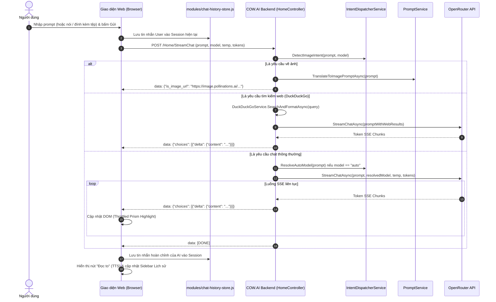

# Thiết kế kiến trúc - COW.AI (Hệ sinh thái Trợ lý AI Đa Tác Vụ)

## 1. Kiểu kiến trúc & lý do chọn
- **Backend:** Kiến trúc Controller-Service phân tầng (Layered Clean Architecture) trên nền ASP.NET Core (.NET 10.0). Tách biệt hoàn toàn Controller (chỉ điều phối HTTP/SSE) khỏi Business Services (`PromptService`, `OpenRouterService`, `DuckDuckGoService`, `IntentDispatcherService`).
- **Frontend:** Mô hình Modular Vanilla JavaScript kết hợp CSS Glassmorphism + Three.js Canvas ngầm định.
- **Lý do chọn:**
  - Tối ưu hóa hiệu năng, giảm thiểu tối đa footprint và sự phụ thuộc vào các framework nặng nề (như React/Angular) khi xây dựng ứng dụng chat thời gian thực.
  - Tuân thủ nguyên tắc **"Zero Hardcoded Prompts"**: Mọi logic tạo câu hỏi cho AI được load động từ tệp mẫu `Prompts/` có cơ chế cache `ConcurrentDictionary`.
  - Tuân thủ nguyên tắc **"Zero Server Database / Zero Hardcoded SQL"**: Không lưu trữ dữ liệu người dùng trên backend; toàn bộ phiên hội thoại được lưu tại `LocalStorage` trình duyệt nhằm hiện thực hóa cam kết *"All chats are private"*.

---

## 2. Công nghệ sử dụng
- **Backend Framework:** .NET 10.0 (C# 14), ASP.NET Core Web App (MVC).
- **AI Integrations:**
  - **OpenRouter API:** Hỗ trợ Gemini 2.0 Flash, DeepSeek R1, Llama 3 8B thông qua SSE stream và non-stream.
  - **Pollinations AI:** Sinh hình ảnh AI miễn phí chất lượng cao từ URL format.
  - **Microsoft Edge TTS:** Chuyển văn bản thành giọng đọc tự nhiên (vi-VN Neural) qua WebSocket/HTTP stream.
  - **DuckDuckGo Search:** Tra cứu dữ liệu trực tiếp không cần API key.
- **Frontend Libraries:**
  - **Three.js:** Không gian 3D tương tác nền với các hạt ánh sáng (particles/geometry).
  - **Marked.js:** Biên dịch Markdown thành HTML an toàn.
  - **Prism.js (Tomorrow Theme):** Định dạng và làm nổi bật cú pháp mã nguồn (C#, Python, JS, Go,...).
  - **Web Speech API:** Nhận diện giọng nói tiếng Việt trực tiếp từ trình duyệt.

---

## 3. Sơ đồ kiến trúc tổng thể

```mermaid
flowchart TD
    subgraph Client ["Client Layer (Trình duyệt Người dùng)"]
        UI["Giao diện Razor View (Index, Shared Layout)"]
        ChatLogic["chat-logic.js (SSE Stream & UI State Controller)"]
        HistoryStore["modules/chat-history-store.js (LocalStorage)"]
        VoiceInput["modules/voice-input.js (Web Speech API)"]
        FileAttachment["modules/file-attachment.js (FileReader)"]
        ThreeBg["three-background.js (Three.js 3D Canvas)"]
    end

    subgraph Backend ["Backend Layer (ASP.NET Core .NET 10)"]
        HomeController["HomeController (StreamChat, GenerateImage)"]
        DocController["DocumentController (Summary, CodeGen)"]
        TtsController["TtsController (Speak API)"]
        
        IntentDispatcher["IntentDispatcherService (Phân luồng ý định & Auto Route)"]
        PromptService["PromptService (Quản lý & Caching Templates ngoài)"]
        OpenRouterService["OpenRouterService (Gọi OpenRouter LLM SSE)"]
        DuckDuckGoService["DuckDuckGoService (Web Search trực tiếp)"]
        EdgeTtsService["EdgeTtsService (Sinh Audio MP3)"]
    end

    subgraph ExternalStorage ["Storage & External Providers"]
        PromptTemplates[("Thư mục Prompts/ (*.txt, *.json)")]
        OpenRouterAPI["OpenRouter AI Gateway (Gemini, DeepSeek, Llama3)"]
        PollinationsAPI["Pollinations AI (Image Engine)"]
        DuckDuckGoAPI["DuckDuckGo HTML Search"]
        EdgeTTSProvider["Microsoft Edge TTS Speech Engine"]
    end

    %% Client Internal Connections
    UI --> ChatLogic
    ChatLogic --> HistoryStore
    ChatLogic --> VoiceInput
    ChatLogic --> FileAttachment
    UI --> ThreeBg

    %% Client to Backend
    ChatLogic -- "POST /Home/StreamChat (SSE)" --> HomeController
    ChatLogic -- "POST /Home/GenerateImage" --> HomeController
    ChatLogic -- "GET /api/tts/speak" --> TtsController
    UI -- "POST /Document/Summary" --> DocController
    UI -- "POST /Document/CodeGen" --> DocController

    %% Backend Dependencies
    HomeController --> IntentDispatcher
    HomeController --> DuckDuckGoService
    HomeController --> OpenRouterService
    HomeController --> PromptService
    DocController --> PromptService
    DocController --> OpenRouterService
    TtsController --> EdgeTtsService

    %% Backend to External
    PromptService -.-> PromptTemplates
    OpenRouterService -.-> OpenRouterAPI
    HomeController -.-> PollinationsAPI
    DuckDuckGoService -.-> DuckDuckGoAPI
    EdgeTtsService -.-> EdgeTTSProvider
```


---

## 4. Danh sách module & Trách nhiệm

| Module / Service | File đảm nhiệm | Trách nhiệm chính |
|------------------|----------------|-------------------|
| `PromptService` | `Services/PromptService.cs` | Tải và cache các template prompt từ `Prompts/`; thực hiện dịch prompt tiếng Việt cho tạo ảnh; định dạng prompt tóm tắt và sinh code. **Zero hardcoded prompts**. |
| `IntentDispatcherService` | `Services/IntentDispatcherService.cs` | Phân tích từ khóa để nhận diện ý định tạo ảnh, chọn model tối ưu (Auto Routing) dựa trên cấu hình `Prompts/AutoRoutingKeywords.json`. |
| `DuckDuckGoService` | `Services/DuckDuckGoService.cs` | Tìm kiếm web DuckDuckGo, làm sạch kết quả và định dạng Markdown danh sách trích dẫn. |
| `OpenRouterService` | `Services/OpenRouterService.cs` | Thực hiện kết nối HTTP Client tới OpenRouter API, xử lý streaming SSE và non-streaming với tham số `temperature` & `maxTokens`. |
| `EdgeTtsService` | `Services/EdgeTtsService.cs` | Kết nối WebSocket tới Microsoft Edge TTS để tạo tệp âm thanh MP3 từ văn bản tiếng Việt. |
| `ChatHistoryStore` | `wwwroot/js/modules/chat-history-store.js` | Lưu trữ, tạo mới, chuyển đổi, xóa và xuất (`.md`) lịch sử trò chuyện trực tiếp tại LocalStorage của trình duyệt. |
| `VoiceInput` | `wwwroot/js/modules/voice-input.js` | Quản lý vòng đời nhận diện giọng nói tiếng Việt bằng Web Speech API, đồng bộ văn bản vào ô nhập lệnh. |
| `FileAttachment` | `wwwroot/js/modules/file-attachment.js` | Đọc tệp văn bản / code client-side qua `FileReader`, tạo chip xem trước và đóng gói vào prompt. |

---

## 5. Mô hình dữ liệu

### 5.1. Client-Side Session Schema (LocalStorage)
Dữ liệu lưu trữ tại key: `cowai_chat_sessions`
```json
[
  {
    "id": "sess_ml2j9x_3a9b1c",
    "title": "Giải thích thuật toán Dijkstra bằng Python",
    "createdAt": 1741234567890,
    "updatedAt": 1741234578120,
    "messages": [
      {
        "role": "user",
        "content": "Viết code Python thuật toán Dijkstra tìm đường đi ngắn nhất",
        "model": "deepseek",
        "timestamp": 1741234567890
      },
      {
        "role": "assistant",
        "content": "Dưới đây là mã nguồn Python chi tiết...",
        "model": "deepseek",
        "timestamp": 1741234578120
      }
    ]
  }
]
```

### 5.2. External Prompt Template Stores (Thư mục `Prompts/`)
- `Prompts/PromptTranslation.txt`: Mẫu dịch câu lệnh tiếng Việt sang đặc tả ảnh tiếng Anh.
- `Prompts/CodeGeneration.txt`: Mẫu chỉ thị chuyên gia lập trình theo ngôn ngữ `{0}`, yêu cầu `{1}`, chi tiết `{2}`.
- `Prompts/DocumentSummary.json`: Cấu hình các phong cách tóm tắt văn bản (`brief`, `detailed`, `bullets`).
- `Prompts/AutoRoutingKeywords.json`: Danh mục từ khóa phân luồng mô hình tự động (`deepseek`, `llama3`, `gemini`).

---

## 6. Thiết kế API Endpoints

| Method | Endpoint | Tham số | Phản hồi | Mô tả |
|--------|----------|---------|----------|-------|
| `POST` | `/Home/StreamChat` | `prompt` (string), `model` (string?), `temperature` (double?), `maxTokens` (int?) | `text/event-stream` | Luồng phản hồi trực tiếp dạng SSE từ LLM hoặc URL ảnh Pollinations. |
| `POST` | `/Home/GenerateImage` | `prompt` (string) | `application/json` (`{ url: "..." }`) | Tạo ảnh độc lập từ câu lệnh. |
| `GET` | `/api/tts/speak` | `text` (string), `voice` (string?) | `audio/mpeg` | Phát giọng đọc thời gian thực. |
| `POST` | `/Document/Summary` | `documentText` (string), `summaryStyle` (string) | `application/json` (`{ summary: "..." }`) | Tóm tắt văn bản theo phong cách. |
| `POST` | `/Document/CodeGen` | `language` (string), `requirement` (string), `framework` (string?) | `application/json` (`{ code: "..." }`) | Sinh mã nguồn chuyên nghiệp. |

---

## 7. Luồng xử lý chính (Sequence Diagram)

### Luồng Chat Trực Tuyến & Lưu Trữ Riêng Tư (Streaming Chat Flow)


---

## 8. Cấu trúc thư mục dự án

```
COW-AI/
├── .agent/                    # Quy chuẩn SDLC, Templates & Skills
│   ├── skills/
│   └── templates/
├── Controllers/               # Web & API Endpoints
│   ├── HomeController.cs      # Chat streaming, DuckDuckGo & Image trigger
│   ├── DocumentController.cs  # Tóm tắt văn bản & Sinh mã nguồn
│   ├── ImageController.cs     # Tạo ảnh chuyên sâu
│   └── TtsController.cs       # API phát âm thanh Edge TTS
├── Services/                  # Business Logic Layer
│   ├── PromptService.cs       # Quản lý & cache prompt ngoài
│   ├── IntentDispatcherService.cs # Điều hướng ý định & auto model
│   ├── DuckDuckGoService.cs   # Tra cứu tìm kiếm web trực tiếp
│   ├── OpenRouterService.cs   # Client gọi OpenRouter API
│   └── EdgeTtsService.cs      # Tổng hợp giọng đọc Edge TTS
├── Prompts/                   # 100% External Prompt Templates
│   ├── PromptTranslation.txt  # Mẫu dịch prompt vẽ ảnh
│   ├── CodeGeneration.txt     # Mẫu sinh mã nguồn đa ngôn ngữ
│   ├── DocumentSummary.json   # Cấu hình phong cách tóm tắt
│   └── AutoRoutingKeywords.json # Bảng tra từ khóa Auto Routing
├── Views/                     # Razor Views & Partials
│   ├── Home/Index.cshtml      # Giao diện chat chính (Duck.ai UX)
│   ├── Shared/_Layout.cshtml  # Khung layout, Navbar, History Drawer
│   └── Shared/_ModelSelector.cshtml # Dropdown chọn model & tham số
├── wwwroot/                   # Static Web Assets
│   ├── css/
│   │   ├── site.css           # Biến màu, Reset, Typography
│   │   ├── components.css     # Navbar, Drawer, Voice, Chips, Glass panels
│   │   └── pages.css          # Chat bubbles, Dock layout, Animation
│   ├── js/
│   │   ├── modules/
│   │   │   ├── chat-history-store.js # Quản lý LocalStorage & Export .md
│   │   │   ├── voice-input.js        # Nhập giọng nói tiếng Việt
│   │   │   └── file-attachment.js    # Đọc tệp văn bản / code client
│   │   ├── chat-logic.js      # Điều phối sự kiện chat & SSE stream
│   │   └── three-background.js# Không gian 3D tương tác
│   └── lib/                   # Marked.js, Prism.js, Three.js
├── docs/                      # Tài liệu SDLC theo chuẩn
│   ├── 01-yeu-cau.md          # Đặc tả yêu cầu (Bước 1)
│   └── 02-kien-truc.md         # Bản thiết kế kiến trúc (Bước 2)
├── tests/                     # 10 Tiers E2E & Unit Test Suites
├── COW-AI.csproj              # Dự án .NET 10 Web App
├── Program.cs                 # Cấu hình DI & Pipeline HTTP
└── .env.example               # Mẫu biến môi trường
```

---

## 9. Quyết định kiến trúc (Architecture Decision Records - ADR)

### ADR-01: Zero Hardcoded Prompts
- **Trạng thái:** ĐÃ THỰC HIỆN VÀ DUYỆT.
- **Bối cảnh:** Trước đây một số prompt hệ thống và chỉ thị AI bị nhúng cứng (hardcoded) trong các Controller C#. Khi cần tối ưu tinh chỉnh câu chữ, lập trình viên buộc phải compile lại mã nguồn.
- **Quyết định:** Tách 100% prompt sang thư mục `Prompts/` dạng `.txt` và `.json`. Lớp `PromptService` chịu trách nhiệm đọc và cache với `ConcurrentDictionary`.
- **Hệ quả:** Có thể cập nhật prompt bất kỳ lúc nào mà không cần build lại dự án; code C# sạch sẽ, đạt chuẩn phân lớp.

### ADR-02: Zero Server Database / Zero Hardcoded SQL
- **Trạng thái:** ĐÃ THỰC HIỆN VÀ DUYỆT.
- **Bối cảnh:** Slogan cốt lõi của COW.AI là *"All chats are private"*. Người dùng cần bảo mật tuyệt đối các câu lệnh, câu hỏi riêng tư.
- **Quyết định:** Không sử dụng SQL Server, Postgres hay bất kỳ cơ sở dữ liệu nào trên server để lưu tin nhắn. Toàn bộ lịch sử phiên chat được quản lý cục bộ tại máy người dùng thông qua `chat-history-store.js` (`localStorage`). Cho phép người dùng chủ động tải về tệp Markdown (`.md`) khi cần.
- **Hệ quả:** 0 rủi ro rò rỉ dữ liệu máy chủ, 0 chi phí lưu trữ DB, tốc độ tải tức thì.

### ADR-03: Throttled Syntax Highlighting trong luồng SSE
- **Trạng thái:** ĐÃ THỰC HIỆN VÀ DUYỆT.
- **Bối cảnh:** Việc gọi `Prism.highlightAllUnder` sau mỗi token đơn lẻ trả về từ SSE khiến trình duyệt phải re-parse cây DOM liên tục, gây tụt khung hình (drop FPS).
- **Quyết định:** Trong lúc đang nhận luồng (`isStreaming = true`), Prism chỉ được kích hoạt theo cơ chế throttle (khoảng 150ms). Khi luồng kết thúc (`[DONE]`), kích hoạt một lần highlight toàn diện.
- **Hệ quả:** Giao diện mượt mà đạt chuẩn 60 FPS ngay cả khi stream hàng ngàn dòng code.

---

## 10. Các cân nhắc bảo mật & Kiểm thử
- **Bảo vệ Secret:** `OpenRouter:ApiKey` lưu trữ thông qua `dotnet user-secrets` hoặc biến môi trường; không bao giờ phơi bày ra client.
- **Làm sạch thông báo lỗi:** Toàn bộ Exception kỹ thuật (`System.*`, `SocketException`, `HttpRequestException`, `sk-*`,...) được lọc qua danh sách Regex đen và thay thế bằng thông báo thân thiện.
- **Chống XSS:** Tin nhắn người dùng luôn được đưa vào DOM thông qua thuộc tính `textContent`. Các thẻ HTML trong Markdown được Marked.js xử lý chặt chẽ.
- **Kiểm thử:** Hệ thống duy trì bộ test 10 Tiers tự động (`tests/run-all-tests.mjs`) bao quát từ unit test, adversarial probe đến E2E HTTP.
