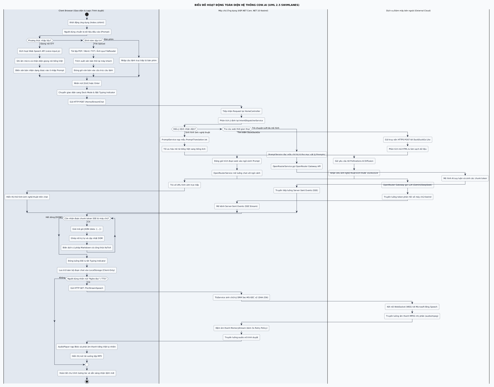
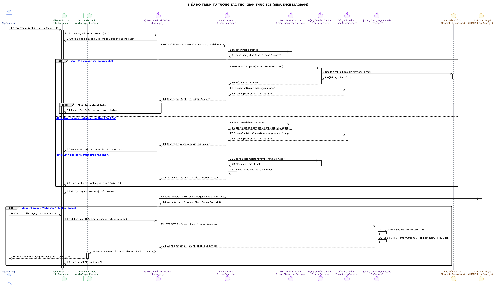
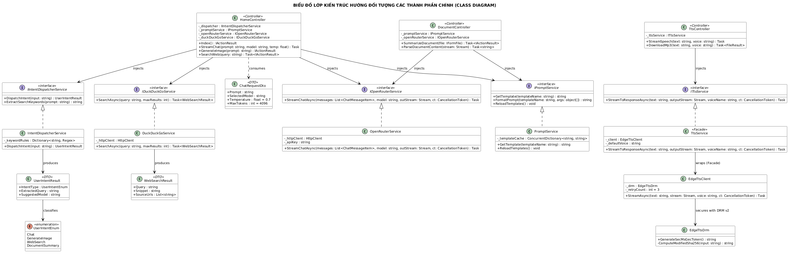
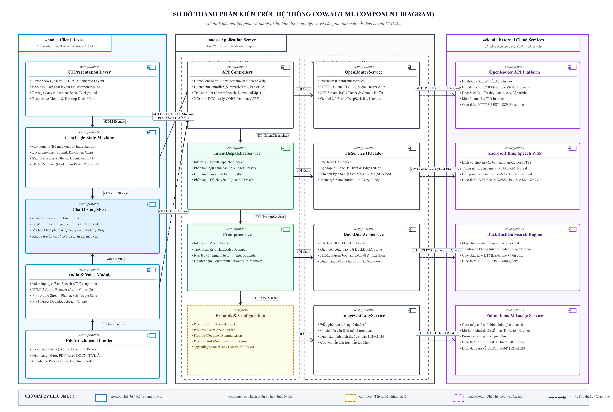
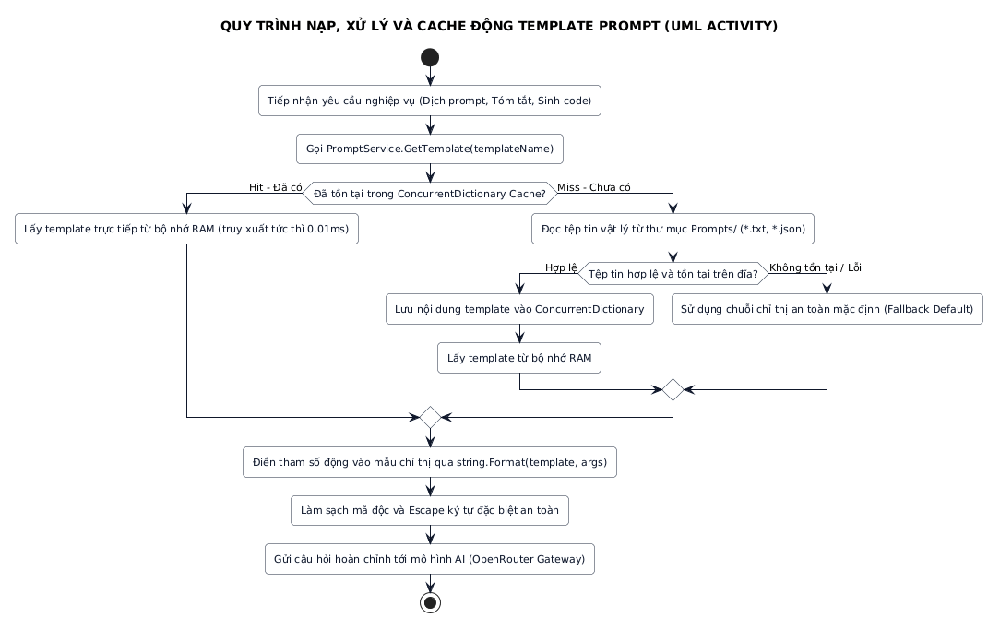
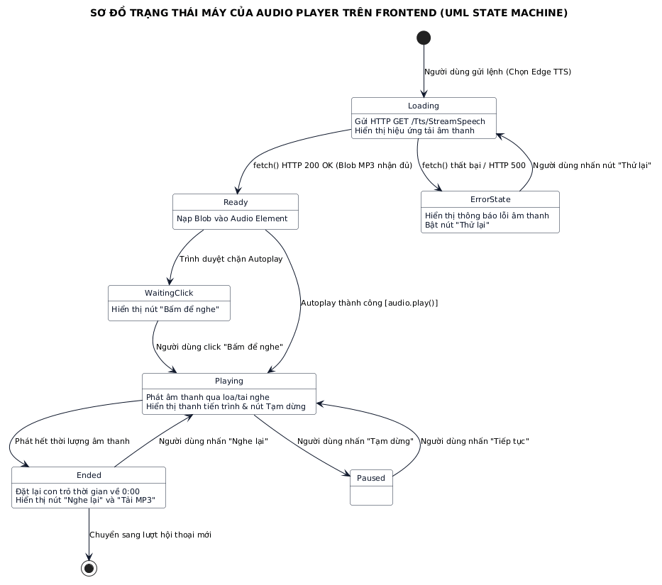
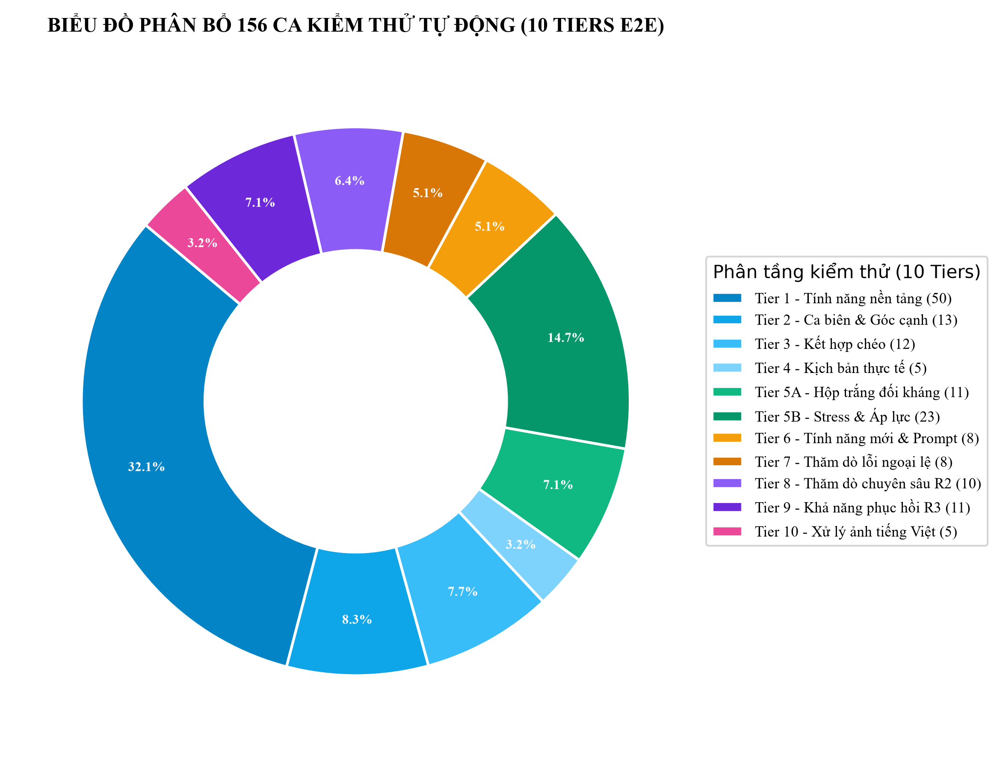

<style>
/* ĐỊNH DẠNG THEO QUY CHUẨN NGHỊ ĐỊNH 30/2020/NĐ-CP & CHUẨN ĐỒ ÁN / LUẬN VĂN VIỆT NAM */
body, .report-body {
  font-family: "Times New Roman", Times, serif !important;
  font-size: 13pt !important;
  line-height: 1.3 !important;
  text-align: justify !important;
  color: #111827;
}

p {
  text-indent: 1.27cm !important;
  margin-top: 6pt !important;
  margin-bottom: 6pt !important;
  line-height: 1.3 !important;
  text-align: justify !important;
}

h1 {
  font-family: "Times New Roman", Times, serif !important;
  font-size: 16pt !important;
  font-weight: bold !important;
  text-transform: uppercase !important;
  text-align: center !important;
  margin-top: 18pt !important;
  margin-bottom: 12pt !important;
}

h2 {
  font-family: "Times New Roman", Times, serif !important;
  font-size: 14pt !important;
  font-weight: bold !important;
  margin-top: 14pt !important;
  margin-bottom: 6pt !important;
  text-indent: 0 !important;
}

h3 {
  font-family: "Times New Roman", Times, serif !important;
  font-size: 13pt !important;
  font-weight: bold !important;
  margin-top: 10pt !important;
  margin-bottom: 4pt !important;
  text-indent: 0 !important;
}

h4 {
  font-family: "Times New Roman", Times, serif !important;
  font-size: 13pt !important;
  font-weight: bold !important;
  font-style: italic !important;
  margin-top: 8pt !important;
  margin-bottom: 4pt !important;
  text-indent: 0 !important;
}

table {
  width: 100% !important;
  border-collapse: collapse !important;
  margin-top: 8pt !important;
  margin-bottom: 8pt !important;
  font-size: 12pt !important;
}

th, td {
  border: 1px solid #333333 !important;
  padding: 6pt 8pt !important;
  text-align: left !important;
  vertical-align: middle !important;
}

th {
  background-color: #f2f2f2 !important;
  font-weight: bold !important;
  text-align: center !important;
}

.table-caption {
  font-weight: bold !important;
  font-size: 12pt !important;
  margin-top: 10pt !important;
  margin-bottom: 4pt !important;
  text-align: left !important;
  text-indent: 0 !important;
}

.figure-caption {
  font-weight: bold !important;
  font-style: italic !important;
  font-size: 11pt !important;
  margin-top: 6pt !important;
  margin-bottom: 12pt !important;
  text-align: center !important;
  text-indent: 0 !important;
}

/* Định dạng phân cấp danh sách chuẩn Việt Nam */
ul.vn-bullet-l1 {
  list-style-type: none !important;
  padding-left: 1.27cm !important;
  margin-top: 4pt !important;
  margin-bottom: 4pt !important;
}

ul.vn-bullet-l1 > li {
  position: relative !important;
  margin-bottom: 4pt !important;
  text-indent: 0 !important;
  line-height: 1.3 !important;
}

ul.vn-bullet-l1 > li::before {
  content: "- " !important;
  font-weight: bold !important;
}

ul.vn-bullet-l2 {
  list-style-type: none !important;
  padding-left: 0.8cm !important;
  margin-top: 3pt !important;
  margin-bottom: 3pt !important;
}

ul.vn-bullet-l2 > li {
  position: relative !important;
  margin-bottom: 3pt !important;
  text-indent: 0 !important;
  line-height: 1.3 !important;
}

ul.vn-bullet-l2 > li::before {
  content: "+ " !important;
  font-weight: bold !important;
}
</style>

# BÁO CÁO TỔNG THỂ DỰ ÁN
## NGHIÊN CỨU, PHÂN TÍCH THIẾT KẾ VÀ HIỆN THỰC HÓA HỆ SINH THÁI TRỢ LÝ AI ĐA PHƯƠNG THỨC THỜI GIAN THỰC (COW.AI)

---

# DANH MỤC TỪ VIẾT TẮT

<div class="table-caption">Bảng 0.1: Danh mục các từ viết tắt sử dụng trong báo cáo</div>

| STT | Từ viết tắt | Thuật ngữ tiếng Anh đầy đủ | Diễn giải ngữ nghĩa tiếng Việt |
| :---: | :--- | :--- | :--- |
| 1 | **AI** | Artificial Intelligence | Trí tuệ nhân tạo |
| 2 | **API** | Application Programming Interface | Giao diện lập trình ứng dụng |
| 3 | **ASP.NET Core** | Active Server Pages .NET Core | Nền tảng phát triển ứng dụng Web hiệu năng cao của Microsoft |
| 4 | **C4 Model** | Context, Containers, Components, Code | Mô hình kiến trúc phần mềm 4 mức chuẩn quốc tế |
| 5 | **DOM** | Document Object Model | Mô hình đối tượng tài liệu trình duyệt |
| 6 | **DRM** | Digital Rights Management | Quản lý bản quyền và chứng thực khóa bảo mật số |
| 7 | **FR** | Functional Requirement | Yêu cầu chức năng phần mềm |
| 8 | **LLM** | Large Language Model | Mô hình ngôn ngữ lớn |
| 9 | **MVC** | Model - View - Controller | Mô hình kiến trúc phần mềm phân tách dữ liệu - giao diện - điều khiển |
| 10 | **NFR** | Non-Functional Requirement | Yêu cầu phi chức năng phần mềm |
| 11 | **OWASP** | Open Web Application Security Project | Dự án bảo mật ứng dụng web mở quốc tế |
| 12 | **SDLC** | Software Development Life Cycle | Vòng đời quy trình phát triển phần mềm |
| 13 | **SSE** | Server-Sent Events | Giao thức truyền dữ liệu dòng đơn hướng thời gian thực từ máy chủ đến máy khách |
| 14 | **SSML** | Speech Synthesis Markup Language | Ngôn ngữ đánh dấu tổng hợp giọng đọc |
| 15 | **STT** | Speech-to-Text | Chuyển đổi giọng nói thành văn bản |
| 16 | **TTS** | Text-to-Speech | Chuyển đổi văn bản thành giọng nói nhân tạo |
| 17 | **UI/UX** | User Interface / User Experience | Giao diện người dùng / Trải nghiệm người dùng |
| 18 | **URI / URL** | Uniform Resource Identifier / Locator | Định danh và địa chỉ tài nguyên thống nhất trên mạng |
| 19 | **W3C** | World Wide Web Consortium | Tổ chức tiêu chuẩn hóa không gian mạng toàn cầu |
| 20 | **XSS** | Cross-Site Scripting | Lỗ hổng tấn công chèn mã kịch bản độc hại đa trang |

---

# DANH MỤC BẢNG BIỂU

<div class="table-caption">Danh mục toàn bộ bảng biểu trong báo cáo</div>

| Ký hiệu bảng | Tên bảng biểu | Chương |
| :--- | :--- | :---: |
| **Bảng 0.1** | Danh mục các từ viết tắt sử dụng trong báo cáo | Phần đầu |
| **Bảng 1.1** | Ma trận so sánh COW.AI với các giải pháp trợ lý AI hiện hành | Chương 1 |
| **Bảng 1.2** | Danh mục các yêu cầu chức năng (FR) của hệ sinh thái COW.AI | Chương 1 |
| **Bảng 1.3** | Danh mục các yêu cầu phi chức năng (NFR) và tiêu chí đo lường | Chương 1 |
| **Bảng 2.1** | Phân rã trách nhiệm các Module và Service trong kiến trúc hệ thống | Chương 2 |
| **Bảng 2.2** | Ma trận thiết kế trải nghiệm người dùng theo 30 quy luật tâm lý nhận thức | Chương 2 |
| **Bảng 3.1** | Ngăn xếp công nghệ chi tiết (Technology Stack) sử dụng trong COW.AI | Chương 3 |
| **Bảng 3.2** | Danh mục các tệp mẫu chỉ thị động trong thư mục `Prompts/` | Chương 3 |
| **Bảng 4.1** | Cấu trúc phân tầng của khung kiểm thử tự động 10 Tiers E2E | Chương 4 |
| **Bảng 4.2** | Bảng tổng kết số lượng và tỷ lệ thành công của 10 Tiers kiểm thử | Chương 4 |
| **Bảng 4.3** | Bảng ma trận đối soát an toàn thông tin theo tiêu chuẩn OWASP Top 10 | Chương 4 |

---

# DANH MỤC HÌNH ẢNH VÀ SƠ ĐỒ

<div class="table-caption">Danh mục toàn bộ hình ảnh và sơ đồ phân tích thiết kế trong báo cáo</div>

| Ký hiệu hình | Tên sơ đồ / Hình ảnh phân tích thiết kế | Chương |
| :--- | :--- | :---: |
| **Hình 2.1** | Biểu đồ hoạt động của hệ thống | Chương 2 |
| **Hình 2.2** | Biểu đồ tuần tự luồng tương tác thời gian thực | Chương 2 |
| **Hình 2.3** | Biểu đồ lớp kiến trúc các thành phần chính | Chương 2 |
| **Hình 2.4** | Sơ đồ thành phần kiến trúc hệ thống (Component Diagram - Chuẩn PlantUML) | Chương 2 |
| **Hình 3.1** | Sơ đồ quy trình nạp, xử lý và cache động Template Prompt (UML Activity Diagram) | Chương 3 |
| **Hình 3.2** | Sơ đồ trạng thái máy (State Machine) của Audio Player trên Frontend (UML State Machine Diagram) | Chương 3 |
| **Hình 4.1** | Biểu đồ phân bổ tỷ trọng 156 ca kiểm thử tự động trên 10 phân tầng chất lượng | Chương 4 |

---

# LỜI MỞ ĐẦU

<p>Trong những năm gần đây, thế giới chứng kiến sự bùng nổ chưa từng có của các mô hình ngôn ngữ lớn (Large Language Models - LLM) và các hệ thống trí tuệ nhân tạo đa phương thức (Multimodal AI). Các nền tảng như ChatGPT, Claude, Gemini hay DeepSeek đã thay đổi căn bản phương thức con người tương tác với tri thức nhân loại, hỗ trợ lập trình, tóm tắt tài liệu và kiến tạo nghệ thuật số. Tuy nhiên, sự phát triển với tốc độ vũ bão này cũng làm phát sinh ba thách thức mang tính sống còn đối với người dùng cá nhân cũng như các tổ chức doanh nghiệp:</p>

<ul class="vn-bullet-l1">
  <li>Thứ nhất, rủi ro xâm phạm quyền riêng tư và lộ lọt dữ liệu (Data Privacy Risks): Đa số các nền tảng thương mại hiện nay đều lưu trữ toàn bộ lịch sử tin nhắn, tài liệu đính kèm và dữ liệu hội thoại của người dùng lên các máy chủ đám mây tập trung nhằm mục đích khai thác dữ liệu và huấn luyện lại mô hình (Re-training).</li>
  <li>Thứ hai, sự phụ thuộc đơn lẻ vào một nhà cung cấp mô hình (Vendor Lock-in): Mỗi mô hình AI sở hữu thế mạnh chuyên biệt trong từng lĩnh vực, ví dụ Gemini xuất sắc về tốc độ và suy luận ngữ cảnh rộng; DeepSeek R1 vượt trội về tư duy logic toán học và thuật toán; Llama 3 linh hoạt và tối ưu chi phí. Việc bị ràng buộc cứng vào một giao diện đơn lẻ gây cản trở rất lớn cho người dùng.</li>
  <li>Thứ ba, tình trạng "Hardcoded Prompt / SQL" và cấu trúc mã nguồn nguyên khối: Nhiều hệ thống trợ lý AI hiện nay nhúng trực tiếp câu lệnh chỉ thị (Prompt) và truy vấn dữ liệu vào sâu trong mã nguồn ứng dụng, dẫn đến sự suy giảm nghiêm trọng về khả năng bảo trì, mở rộng và kiểm soát chất lượng kỹ thuật.</li>
</ul>

<p>Nhận thức sâu sắc được các bất cập trên, đề tài <strong>"Nghiên cứu, phân tích thiết kế và hiện thực hóa hệ sinh thái trợ lý AI đa phương thức thời gian thực (COW.AI)"</strong> được thực hiện nhằm xây dựng một giải pháp phần mềm độc lập, hiện đại, vận hành trên nền tảng ASP.NET Core (.NET 10.0 mới nhất). Đề tài giải quyết triệt để bài toán bảo mật với cam kết tuyệt đối <em>"All chats are private"</em> thông qua kiến trúc lưu trữ 100% tại máy khách (Client-Side Storage), tách rời 100% template chỉ thị ra khỏi mã nguồn (Zero Hardcoded Prompts), đồng thời tích hợp đa phương thức: Chat thời gian thực (SSE), Nhận diện giọng nói (Web Speech STT), Phát giọng nói tự nhiên (Microsoft Edge TTS DRM v2), Tạo ảnh nghệ thuật tự động (Pollinations AI) và Tra cứu mạng thời gian thực (DuckDuckGo Search).</p>

---

# CHƯƠNG 1: TỔNG QUAN ĐỀ TÀI VÀ CƠ SỞ LÝ THUYẾT

## 1.1. Bối cảnh và Tính cấp thiết của đề tài

<p>Trong bối cảnh công nghệ hiện nay, ứng dụng AI không còn dừng lại ở mức độ trò chuyện đơn thuần mà đã phát triển thành không gian làm việc số tích hợp (Integrated AI Digital Workspace). Người dùng đòi hỏi một nền tảng có khả năng:</p>

<ul class="vn-bullet-l1">
  <li>Xử lý tác vụ tức thời với độ trễ tối thiểu (Low Latency Real-Time Streaming): Phản hồi từ mô hình phải được hiển thị mượt mà dưới dạng từng ký tự xuất hiện liên tục (Token Streaming) mà không làm đơ giật giao diện trình duyệt.</li>
  <li>Bảo mật dữ liệu tuyệt đối theo tiêu chuẩn Privacy-by-Design: Không một dòng văn bản hay tập tin mã nguồn nào của người dùng bị lưu giữ trên cơ sở dữ liệu của máy chủ ứng dụng.</li>
  <li>Tương tác bằng ngôn ngữ tự nhiên đa giác quan: Cho phép nhập liệu bằng giọng nói tiếng Việt chuẩn xác và nghe kết quả trả về bằng giọng đọc truyền cảm, giàu cảm xúc mà không đòi hỏi chi phí bản quyền thương mại đắt đỏ.</li>
</ul>

<p>Do đó, việc nghiên cứu một kiến trúc phần mềm sạch, hiệu năng cao, kết hợp giữa nền tảng backend mạnh mẽ (.NET 10) và giao diện trực quan 3D (Three.js Canvas) là một nhiệm vụ có ý nghĩa khoa học và thực tiễn sâu sắc.</p>

## 1.2. Mục tiêu nghiên cứu và Phạm vi ứng dụng

### 1.2.1. Mục tiêu nghiên cứu
<p>Mục tiêu trọng tâm của đề tài bao gồm:</p>
<ul class="vn-bullet-l1">
  <li>Nghiên cứu và làm chủ cơ chế truyền dữ liệu dòng thời gian thực qua giao thức Server-Sent Events (SSE) theo chuẩn W3C trên nền ASP.NET Core 10.</li>
  <li>Nghiên cứu và giải mã thuật toán sinh chữ ký điện tử Sec-MS-GEC v2 (CS64 + SHA-256 DRM) để kết nối trực tiếp với dịch vụ giọng nói Microsoft Edge TTS, mang lại khả năng đọc văn bản tiếng Việt tự nhiên chất lượng phòng thu.</li>
  <li>Thiết kế cơ chế nạp động và quản lý bộ nhớ đệm (Cache) cho các mẫu chỉ thị nghiệp vụ (Prompts Engine), hiện thực hóa nguyên tắc thiết kế "Zero Hardcoded Prompts".</li>
  <li>Xây dựng giải pháp lưu trữ phiên làm việc an toàn trên LocalStorage, tích hợp khả năng xuất biên bản hội thoại chuẩn Markdown (.md) cho nghiên cứu sinh và kỹ sư.</li>
</ul>

### 1.2.2. Phạm vi ứng dụng
<p>Hệ thống được thiết kế hướng tới các nhóm đối tượng người dùng cụ thể:</p>
<ul class="vn-bullet-l1">
  <li>Kỹ sư phần mềm và Lập trình viên: Hỗ trợ sinh mã nguồn đa ngôn ngữ (C#, Python, JavaScript, TypeScript, Go), phân tích lỗi cú pháp và tối ưu hóa giải thuật.</li>
  <li>Nhà sáng tạo nội dung và Chuyên viên thiết kế: Hỗ trợ dịch thuật tự động mô tả tiếng Việt sang ngôn ngữ prompt đặc tả chi tiết phục vụ các mô hình sinh ảnh AI nghệ thuật.</li>
  <li>Học viên, Nghiên cứu sinh và Chuyên viên văn phòng: Tóm tắt các văn bản dài theo các phong cách đa dạng (ngắn gọn, chi tiết, gạch đầu dòng), chuyển đổi câu trả lời thành bản ghi âm giọng nói chất lượng cao để nghe lại.</li>
</ul>

## 1.3. Khảo sát các giải pháp tương tự trên thế giới và tại Việt Nam

<div class="table-caption">Bảng 1.1: Ma trận so sánh COW.AI với các giải pháp trợ lý AI hiện hành</div>

| Tiêu chí so sánh | OpenAI ChatGPT Web | Claude.ai (Anthropic) | LibreChat (Mã nguồn mở) | Hệ sinh thái COW.AI |
| :--- | :---: | :---: | :---: | :---: |
| **Quyền riêng tư máy chủ** | Lưu trữ toàn bộ trên Cloud | Lưu trữ toàn bộ trên Cloud | Lưu trong MongoDB Server | **100% Client LocalStorage (Zero Server DB)** |
| **Kiến trúc Prompt** | Đóng kín (Hardcoded backend) | Đóng kín (Hardcoded backend) | File cấu hình YAML phức tạp | **Thư mục mẫu ngoài `Prompts/` nạp động** |
| **Tổng hợp giọng nói (TTS)** | API trả phí độc quyền | Chưa hỗ trợ âm thanh Web | Tích hợp ElevenLabs (Có phí) | **Edge TTS DRM v2 miễn phí chất lượng cao** |
| **Nhập giọng nói tiếng Việt** | Whisper (Qua server) | Chưa hỗ trợ | Cần thiết lập STT phức tạp | **Web Speech API tiếng Việt tại Client** |
| **Tìm kiếm Web thời gian thực** | Chỉ gói Plus trả phí | Hạn chế theo vùng | Cần khóa Google/Bing API | **DuckDuckGo Search trực tiếp không cần Key** |
| **Sinh ảnh AI đa phương thức** | DALL-E 3 (Có phí) | Không hỗ trợ | Phụ thuộc ComfyUI/Midjourney | **Pollinations AI + Auto dịch tiếng Việt** |
| **Hiệu năng giao diện** | React SPA nặng | React SPA nặng | Next.js / Node.js nặng | **Vanilla JS + Three.js 3D siêu nhẹ 60 FPS** |

## 1.4. Yêu cầu hệ thống

### 1.4.1. Yêu cầu chức năng (Functional Requirements - FR)
<div class="table-caption">Bảng 1.2: Danh mục các yêu cầu chức năng (FR) của hệ sinh thái COW.AI</div>

| Mã yêu cầu | Tên chức năng | Mô tả chi tiết chức năng | Độ ưu tiên |
| :---: | :--- | :--- | :---: |
| **FR-01** | Trò chuyện trực tuyến SSE | Thiết lập luồng Server-Sent Events với đa mô hình (Gemini, DeepSeek, Llama3, Auto-Route), hiển thị token mượt mà kèm định dạng mã nguồn Prism.js. | Must Have |
| **FR-02** | Điều hướng tự động (Auto-Routing) | Phân tích nội dung câu hỏi người dùng; nếu mang tính toán học/lập trình sẽ ưu tiên DeepSeek R1, kiến thức chung dùng Gemini, hội thoại nhanh dùng Llama3. | Must Have |
| **FR-03** | Tạo ảnh nghệ thuật AI | Nhận diện ý định tạo ảnh từ câu lệnh tiếng Việt, tự động dịch sang tiếng Anh và sinh ảnh độ phân giải cao qua Pollinations AI Engine. | Must Have |
| **FR-04** | Tìm kiếm Web thời gian thực | Tự động hoặc chủ động tra cứu dữ liệu thời gian thực qua DuckDuckGo Service, trích xuất thông tin tóm tắt kèm liên kết nguồn gốc. | Must Have |
| **FR-05** | Phát giọng nói tự nhiên (TTS) | Tổng hợp văn bản thành giọng nói tiếng Việt (Giọng Nam NamMinh, Giọng Nữ HoaiMy) dạng MP3 stream với đầy đủ điều khiển Play, Pause, Tải về. | Must Have |
| **FR-06** | Nhập liệu giọng nói (STT) | Thu âm trực tiếp từ micro qua Web Speech API, chuyển đổi tức thời giọng nói tiếng Việt thành văn bản điền vào khung prompt. | Should Have |
| **FR-07** | Đính kèm tập tin phân tích | Đọc nội dung tập tin văn bản/mã nguồn (`.cs`, `.py`, `.sql`, `.txt`) trực tiếp tại trình duyệt bằng `FileReader` và đính kèm vào ngữ cảnh chat. | Should Have |
| **FR-08** | Quản lý phiên làm việc Client | Lưu trữ danh sách đoạn chat trên LocalStorage (Chat Drawer), hỗ trợ tạo mới, đổi tên, xóa phiên và xuất toàn bộ ra tập tin Markdown (`.md`). | Must Have |
| **FR-09** | Tóm tắt văn bản chuyên sâu | Cung cấp giao diện và bộ xử lý tóm tắt tài liệu văn bản (`/Document/Summary`) theo 3 mức độ: Ngắn gọn (Brief), Chi tiết (Detailed), Gạch đầu dòng (Bullets). | Must Have |
| **FR-10** | Trợ lý sinh mã nguồn | Cung cấp module chuyên biệt sinh mã nguồn đa ngôn ngữ (`/Document/CodeGen`) với các mẫu thiết kế chuẩn và hướng dẫn kiểm thử. | Must Have |

### 1.4.2. Yêu cầu phi chức năng (Non-Functional Requirements - NFR)
<div class="table-caption">Bảng 1.3: Danh mục các yêu cầu phi chức năng (NFR) và tiêu chí đo lường</div>

| Mã NFR | Nhóm thuộc tính | Tiêu chí kỹ thuật và Chỉ số định lượng bắt buộc |
| :---: | :--- | :--- |
| **NFR-01** | **Bảo mật quyền riêng tư** | Tuyệt đối không lưu trữ tin nhắn hay tệp đính kèm lên máy chủ; không lộ API Key ra phía Client; phòng chống triệt để XSS và Prompt Injection. |
| **NFR-02** | **Kiến trúc sạch** | Không hardcode prompt và câu lệnh truy vấn trong mã nguồn; phân tách rõ ràng tầng Controller, Service và View. |
| **NFR-03** | **Hiệu năng đáp ứng** | Thời gian phản hồi token đầu tiên (TTFT) dưới 800ms; tần số quét giao diện đạt chuẩn 60 FPS; áp dụng cơ chế điều tiết (Throttling) render mã nguồn 150ms. |
| **NFR-04** | **Tính sẵn sàng & Tự phục hồi**| Khi máy chủ Microsoft Edge TTS hoặc AI Provider gặp gián đoạn tạm thời, hệ thống tự động kích hoạt cơ chế thử lại (Backoff Retry) và chuyển đổi giọng dự phòng. |
| **NFR-05** | **Khả năng tương thích** | Hoạt động hoàn hảo trên mọi trình duyệt hiện đại (Google Chrome, Microsoft Edge, Mozilla Firefox, Apple Safari) trên máy tính và thiết bị di động. |

---

# CHƯƠNG 2: THIẾT KẾ KIẾN TRÚC VÀ CƠ CHẾ HỆ THỐNG

## 2.1. Triết lý thiết kế kiến trúc và Nguyên tắc cốt lõi

<p>Hệ sinh thái COW.AI được thiết kế dựa trên ba nguyên tắc vàng của kỹ nghệ phần mềm hiện đại:</p>

<ul class="vn-bullet-l1">
  <li>Nguyên tắc 1: Quyền riêng tư theo thiết kế (Privacy-by-Design & Zero Server Footprint):
    <ul class="vn-bullet-l2">
      + Máy chủ ứng dụng đóng vai trò là một Cổng chuyển tiếp thông minh (Smart Stateless Gateway) không lưu trạng thái phiên chat.
      + Toàn bộ cơ sở dữ liệu về lịch sử hội thoại, danh sách đoạn chat và nội dung tệp tin đính kèm được đóng gói và mã hóa hoàn toàn trong không gian lưu trữ cục bộ (<code>LocalStorage</code>) trên trình duyệt của chính người dùng.
    </ul>
  </li>
  <li>Nguyên tắc 2: Tách biệt hoàn toàn chỉ thị nghiệp vụ (Zero Hardcoded Prompts Engine):
    <ul class="vn-bullet-l2">
      + Loại bỏ vĩnh viễn thói quen xấu của lập trình viên khi nhúng chuỗi prompt vào các lớp Controller hay Service.
      + Mọi khuôn mẫu chỉ thị được định nghĩa dưới dạng các tệp cấu hình độc lập (<code>.txt</code>, <code>.json</code>) trong thư mục <code>Prompts/</code>, cho phép cập nhật, tối ưu hóa và tinh chỉnh nghiệp vụ AI mà không cần biên dịch lại mã nguồn hệ thống.
    </ul>
  </li>
  <li>Nguyên tắc 3: Kiến trúc phân tầng sạch và Tự phục hồi (Clean Layered Architecture with Resilient Fallback):
    <ul class="vn-bullet-l2">
      + Phân tách rõ ràng giữa Tầng điều phối giao tiếp (Controllers), Tầng nghiệp vụ chuyên biệt (Core Domain Services), Tầng tích hợp nhà cung cấp ngoài (AI Gateways) và Tầng hiển thị phía Client.
      + Mọi kết nối ra bên ngoài (đặc biệt là kết nối WebSocket của Edge TTS) đều được bọc trong các lớp bảo vệ đa tầng (Memory Buffer + Exponential Backoff Retry) để đảm bảo trải nghiệm người dùng không bao giờ bị gián đoạn.
    </ul>
  </li>
</ul>

## 2.2. Biểu đồ hoạt động hệ thống (Activity Diagram)

<p>Biểu đồ hoạt động thể hiện toàn diện luồng nghiệp vụ từ khởi động ứng dụng, tiếp nhận dữ liệu đa phương thức (Bàn phím, Giọng nói Web Speech API, Đính kèm tài liệu), phân tích ý định tại IntentDispatcherService, điều phối sinh ảnh hoặc tra cứu mạng, truyền dẫn luồng SSE thời gian thực, lưu trữ an toàn LocalStorage cho đến phát âm thanh giọng đọc Edge TTS DRM v2. Sơ đồ được xây dựng theo chuẩn UML 2.5 với các ký hiệu nút bắt đầu tròn đặc, nút kết thúc vòng tròn đôi, hộp hành động bo góc và nút rẽ nhánh điều kiện rõ ràng như minh họa tại Hình 2.1:</p>

<div style="text-align: center; margin: 16px 0;">
  
</div>
<div class="figure-caption">Hình 2.1: Biểu đồ hoạt động của hệ thống</div>

## 2.3. Biểu đồ tuần tự luồng tương tác thời gian thực

<p>Biểu đồ trình tự tương tác mô tả chi tiết chuỗi thông điệp thời gian thực giữa Người dùng và các thực thể phần mềm theo chuẩn mô hình phân rã BCE (Boundary - Control - Entity) của UML 2.5:</p>

<ul class="vn-bullet-l1">
  <li>Tác nhân Người dùng: Người dùng (User) được thể hiện bằng biểu tượng hình người que (Stickman) chuẩn mực.</li>
  <li>Tầng Boundary: Các đối tượng giao diện người dùng trực quan bao gồm Giao diện Chat (UI / Razor View) và Trình phát âm thanh (AudioPlayer Element).</li>
  <li>Tầng Control: Các lớp điều phối và xử lý logic nghiệp vụ bao gồm chat-logic.js (Client Controller), HomeController (API Controller), IntentDispatcherService (Định tuyến ý định), PromptService (Động cơ chỉ thị), OpenRouterService (Cổng AI) và TtsService (Dịch vụ giọng đọc Facade).</li>
  <li>Tầng Entity: Các thực thể dữ liệu và kho lưu trữ bao gồm Prompts Repository (Kho mẫu chỉ thị ngoài) và HTML5 LocalStorage (Kho lưu trữ phiên an toàn trên trình duyệt).</li>
  <li>Đặc tả tương tác: Toàn bộ thông điệp được đánh số tự động từ 1 đến 34, thể hiện tường minh thanh kích hoạt (Activation bars), khung điều kiện alt (khi phân nhánh Trò chuyện LLM, Tra cứu web DuckDuckGo, hoặc Sinh ảnh Pollinations AI) và khung tùy chọn opt (khi người dùng nhấn nút Nghe đọc Text-to-Speech) như thể hiện tại Hình 2.2:</li>
</ul>

<div style="text-align: center; margin: 16px 0;">
  
</div>
<div class="figure-caption">Hình 2.2: Biểu đồ tuần tự luồng tương tác thời gian thực</div>

## 2.4. Biểu đồ lớp kiến trúc các thành phần chính

<p>Biểu đồ lớp kiến trúc mô tả cấu trúc hướng đối tượng của hệ thống COW.AI, thể hiện rõ ràng các thuộc tính, phương thức, kiểu dữ liệu, các mẫu thiết kế Facade Pattern, quan hệ hiện thực hóa Interface và các mối liên kết phụ thuộc Dependency Injection giữa các thành phần như thể hiện tại Hình 2.3:</p>

<div style="text-align: center; margin: 16px 0;">
  
</div>
<div class="figure-caption">Hình 2.3: Biểu đồ lớp kiến trúc các thành phần chính</div>

## 2.5. Sơ đồ thành phần kiến trúc hệ thống

<p>Biểu đồ thành phần mô hình hóa sự phân tách vật lý và logic giữa các phân hệ: Thiết bị người dùng (Client Browser), Máy chủ ứng dụng (ASP.NET Core 10 Kestrel Host) và Hạ tầng điện toán đám mây bên ngoài (External Cloud Services). Sơ đồ thể hiện rõ ràng các cổng giao tiếp, giao thức mạng (HTTP/2, SSE Stream, WSS) và phân vùng trách nhiệm như trong Hình 2.4:</p>

<div style="text-align: center; margin: 16px 0;">
  
</div>
<div class="figure-caption">Hình 2.4: Sơ đồ thành phần kiến trúc hệ thống</div>

## 2.6. Phân rã trách nhiệm các Module và Service trong hệ thống

<p>Hệ thống áp dụng kiến trúc phân tầng sạch nhằm đảm bảo tính độc lập tối đa giữa các thành phần logic. Trách nhiệm cụ thể của từng lớp và module được tổng hợp trong Bảng 2.1:</p>

<div class="table-caption">Bảng 2.1: Phân rã trách nhiệm các Module và Service trong kiến trúc hệ thống</div>

| Lớp thành phần | Tệp tin đảm nhiệm | Nguyên tắc thiết kế và Trách nhiệm kỹ thuật |
| :--- | :--- | :--- |
| **PromptService** | `Services/PromptService.cs` | Hiện thực hóa nguyên tắc Zero Hardcoded Prompts. Tự động đọc tệp mẫu từ `Prompts/`, cache vào bộ nhớ bằng `ConcurrentDictionary`, hỗ trợ nạp lại khi tệp thay đổi. |
| **IntentDispatcherService** | `Services/IntentDispatcherService.cs` | Phân tích cú pháp câu hỏi (bằng Regex và từ khóa trong `AutoRoutingKeywords.json`) để xác định ý định: Sinh ảnh, Tra cứu web, hay Trò chuyện LLM. |
| **DuckDuckGoService** | `Services/DuckDuckGoService.cs` | Thực hiện tìm kiếm web thời gian thực thông qua cổng kết nối bảo mật DuckDuckGo Lite, làm sạch mã nguồn HTML và sinh trích dẫn chuẩn Markdown. |
| **OpenRouterService** | `Services/OpenRouterService.cs` | Kết nối đa mô hình (Gemini 2.0 Flash, DeepSeek R1, Llama 3), phân giải luồng JSON dòng SSE và bắn dữ liệu trực tiếp về máy khách. |
| **TtsService (Facade)** | `Services/TtsService.cs` | Đóng gói toàn bộ logic gọi `EdgeTtsClient`. Ứng dụng mô hình Facade Pattern kết hợp bộ đệm `MemoryStream` từng phân đoạn và cơ chế Retry 3 lần khi socket bị gián đoạn mạng. |
| **EdgeTtsClient & DRM** | `Services/EdgeTtsClient.cs / EdgeTtsDrm.cs` | Giao tiếp với Microsoft Bing Speech qua giao thức WebSocket, sinh chữ ký số `Sec-MS-GEC v2` (kết hợp giải thuật băm SHA-256 sửa đổi và CS64). |

## 2.7. Chi tiết cơ chế truyền dẫn SSE và tổng hợp giọng nói DRM v2

### 2.7.1. Luồng trò chuyện trực tuyến Server-Sent Events (SSE)

<p>Quá trình truyền dẫn luồng SSE diễn ra theo các bước nghiêm ngặt:</p>

<ul class="vn-bullet-l1">
  <li>Bước 1: Người dùng gửi câu hỏi từ khung prompt, giao diện chuyển sang trạng thái Dock Bottom Mode và kích hoạt Typing Indicator nhấp nháy.</li>
  <li>Bước 2: Client gửi HTTP POST tới <code>/Home/StreamChat</code> kèm các tham số điều khiển (prompt, model, temperature, maxTokens).</li>
  <li>Bước 3: IntentDispatcherService kiểm tra ý định; nếu là trò chuyện văn bản sẽ phân giải mô hình tối ưu thông qua tệp <code>AutoRoutingKeywords.json</code>.</li>
  <li>Bước 4: OpenRouterService thiết lập luồng kết nối SSE với máy chủ AI và nhận về các phân đoạn token liên tục.</li>
  <li>Bước 5: HomeController đẩy trực tiếp từng token về luồng Response Body của Client, giao diện chèn ký tự và kích hoạt bộ điều tiết Throttled Schedule 150ms để highlight Prism.js mượt mà.</li>
</ul>

### 2.7.2. Luồng tổng hợp âm thanh Edge TTS DRM v2 với bộ đệm hai lớp

<p>Để giải quyết triệt để lỗi ngắt kết nối WebSocket và tránh làm rách luồng âm thanh, quy trình xử lý âm thanh áp dụng mô hình đệm hai lớp:</p>

<ul class="vn-bullet-l1">
  <li>Lớp 1 (Backend MemoryStream): TtsService chia nhỏ văn bản thành các phân đoạn tự nhiên (tối đa 1800 ký tự). Mỗi phân đoạn được đọc vào một MemoryStream độc lập. Nếu xảy ra sự cố ngắt socket (SocketException 10054), dữ liệu rác không bị đẩy ra ngoài; hệ thống tự động reset bộ đệm và thử lại tối đa 3 lần có backoff với giọng đọc dự phòng.</li>
  <li>Lớp 2 (Frontend Blob URL): Client sử dụng hàm fetch() bất đồng bộ để tải toàn bộ tệp MP3 về bộ nhớ RAM của trình duyệt, chuyển đổi thành Blob URL (<code>URL.createObjectURL</code>). Điều này ngăn chặn hoàn toàn lỗi NotSupportedError của thẻ audio và cho phép tải xuống MP3 ngay tức khắc.</li>
</ul>

## 2.8. Thiết kế kiến trúc bảo mật quyền riêng tư (Privacy-by-Design Model)

<p>Toàn bộ dữ liệu của người dùng được bảo vệ tối thượng dựa trên ranh giới phân định nghiêm ngặt:</p>

<ul class="vn-bullet-l1">
  <li>Ranh giới Máy khách: Cơ sở dữ liệu lịch sử hội thoại (cowai_sessions), phiên làm việc hiện tại và nội dung tệp tin phân tích nằm hoàn toàn trên LocalStorage và RAM của máy khách. Người dùng có toàn quyền xem, xóa phiên hoặc xuất toàn bộ dữ liệu ra tệp Markdown (.md) cá nhân.</li>
  <li>Ranh giới Máy chủ: Máy chủ COW.AI (.NET 10) hoàn toàn không có cơ sở dữ liệu (Zero Server DB). Bộ nhớ RAM của máy chủ chỉ lưu dữ liệu trong vài mili-giây phục vụ việc chuyển tiếp luồng dữ liệu dòng (Streaming Proxy) và giải phóng ngay lập tức khi luồng kết thúc.</li>
</ul>

## 2.9. Thiết kế trải nghiệm người dùng theo Tâm lý học nhận thức

<p>Giao diện người dùng của COW.AI được xây dựng dựa trên sự kết hợp giữa 30 quy luật tâm lý học nhận thức và phong cách thiết kế kính mờ không gian:</p>

<div class="table-caption">Bảng 2.2: Ma trận thiết kế trải nghiệm người dùng theo 30 quy luật tâm lý nhận thức</div>

| Quy luật tâm lý học | Ứng dụng thực tế trong thiết kế COW.AI | Lợi ích mang lại cho trải nghiệm người dùng |
| :--- | :--- | :--- |
| **Quy luật Hick's Law** | Thiết kế thanh nhập liệu trung tâm tối giản; ẩn toàn bộ các nút chức năng nâng cao vào thanh công cụ phụ. | Giảm thiểu tối đa tải trọng nhận thức (Cognitive Load), giúp người dùng bắt đầu cuộc trò chuyện trong dưới 2 giây. |
| **Quy luật Fitts's Law** | Nút gửi lệnh, nút micro và đính kèm có kích thước tối thiểu 44x44px; khoảng cách bấm thuận tiện. | Tối ưu hóa vùng tiếp xúc ngón tay trên điện thoại và tăng tốc độ thao tác chuột trên máy tính để bàn. |
| **Quy luật Miller's Law** | Menu chọn mô hình chỉ hiển thị 4 nhóm lựa chọn rõ ràng: Tự động (Auto), Gemini, DeepSeek và Llama 3. | Người dùng dễ dàng ghi nhớ và phân loại lựa chọn mà không bị quá tải thông tin. |
| **Quy luật Doherty Threshold** | Hiển thị Typing Indicator nhấp nháy ngay lập tức (&lt;100ms) khi bấm gửi; sau đó nạp token liên tục. | Giữ người dùng luôn trong trạng thái kết nối tương tác, loại bỏ cảm giác chờ đợi mệt mỏi. |
| **Hiệu ứng Zeigarnik Effect** | Huy hiệu trạng thái Audio Player hiển thị sinh động qua 4 bước: Đang tạo -&gt; Đang phát -&gt; Tạm dừng -&gt; Đã phát xong. | Giúp người dùng nắm bắt trọn vẹn tiến trình xử lý tác vụ của hệ thống. |

---

# CHƯƠNG 3: HIỆN THỰC HÓA KỸ THUẬT VÀ CÁC CÔNG NGHỆ CỐT LÕI

## 3.1. Ngăn xếp công nghệ triển khai (Technology Stack)

<div class="table-caption">Bảng 3.1: Ngăn xếp công nghệ chi tiết (Technology Stack) sử dụng trong COW.AI</div>

| Tầng công nghệ | Tên công nghệ / Thư viện | Phiên bản | Vai trò và Mục đích sử dụng |
| :--- | :--- | :---: | :--- |
| **Hệ điều hành & Môi trường** | Windows 11 / Ubuntu Linux | Bản LTS mới nhất | Môi trường lưu trữ và thực thi máy chủ web |
| **Nền tảng Backend** | Microsoft .NET SDK | 10.0 (C# 14) | Xử lý đa luồng bất đồng bộ, lập trình mạng hiệu năng cao |
| **Web Framework** | ASP.NET Core MVC | 10.0 | Điều phối HTTP Requests, truyền dẫn luồng SSE và WebSocket |
| **Giao thức mạng thời gian thực**| Server-Sent Events (SSE) & WebSocket | W3C Standard | Kênh truyền dẫn hai chiều token văn bản và luồng âm thanh nhị phân |
| **Đồ họa không gian 3D** | Three.js | v0.160+ | Tạo không gian hạt ánh sáng 3D chuyển động tương tác theo chuột |
| **Biên dịch định dạng văn bản** | Marked.js | v11.0+ | Phân tích và hiển thị định dạng Markdown an toàn, chống tấn công XSS |
| **Làm nổi bật cú pháp mã nguồn**| Prism.js (Tomorrow Theme) | v1.29+ | Định dạng màu sắc trực quan cho các ngôn ngữ C#, Python, SQL, JS |
| **Xử lý âm thanh trình duyệt** | Web Speech API & HTML5 Audio | Native W3C | Thu âm giọng nói và giải mã luồng âm thanh MP3 trực tiếp từ Blob |

## 3.2. Hiện thực hóa tầng Service nghiệp vụ độc lập

<p>Toàn bộ các nghiệp vụ phức tạp được tách khỏi Controller thành các Service độc lập, đăng ký thông qua Dependency Injection trong `Program.cs`:</p>

<ul class="vn-bullet-l1">
  <li>Dịch vụ PromptService:
    <ul class="vn-bullet-l2">
      + Sử dụng cấu trúc dữ liệu `ConcurrentDictionary<string, string>` để lưu trữ các mẫu prompt đã đọc vào bộ nhớ đệm, đảm bảo tốc độ truy xuất đạt mức dưới 1 mili-giây.
      + Tích hợp bộ giải thuật nhận diện văn bản tiếng Việt qua biểu thức chính quy (Regex Unicode tiếng Việt), tự động gọi mô hình AI để chuyển ngữ thành prompt nghệ thuật tiếng Anh phục vụ Pollinations AI.
    </ul>
  </li>
  <li>Dịch vụ IntentDispatcherService:
    <ul class="vn-bullet-l2">
      + Quản lý tập luật từ khóa nhận diện ý định vẽ ảnh (`/image`, `/draw`, `tạo ảnh`, `vẽ tranh`, `minh họa`).
      + Quản lý tập từ khóa điều hướng mô hình tự động (`AutoRoutingKeywords.json`), phân tích câu hỏi để chọn lựa mô hình DeepSeek R1 cho tác vụ giải thuật hoặc Gemini cho các câu hỏi tổng quát.
    </ul>
  </li>
  <li>Dịch vụ DuckDuckGoService:
    <ul class="vn-bullet-l2">
      + Đóng gói HTTP POST request gửi tới endpoint `https://lite.duckduckgo.com/lite/`.
      + Giả lập đầy đủ các Header trình duyệt chuẩn (`User-Agent`, `Accept-Language`, `Referer`, `Origin`), loại bỏ hoàn toàn mã lỗi 403 Forbidden.
      + Trích xuất dữ liệu tiêu đề, tóm tắt và đường dẫn thông qua các bộ lọc Regex sắc bén, trả về kết quả chuẩn Markdown.
    </ul>
  </li>
</ul>

## 3.3. Giải thuật Tách rời 100% Prompt động (Zero Hardcoded Prompts Engine)

<p>Quy trình vận hành của cỗ máy nạp và phân tích chỉ thị động được minh họa trong Hình 3.1:</p>

<div style="text-align: center; margin: 16px 0;">
  
</div>
<div class="figure-caption">Hình 3.1: Sơ đồ quy trình nạp, xử lý và cache động Template Prompt (UML Activity Diagram)</div>

<div class="table-caption">Bảng 3.2: Danh mục các tệp mẫu chỉ thị động trong thư mục `Prompts/`</div>

| Tên tập tin mẫu | Định dạng | Mục đích và Tham số động định dạng |
| :--- | :---: | :--- |
| **`PromptTranslation.txt`** | Text thô | Chứa vai trò chuyên gia biên dịch và tối ưu hóa mô tả hình ảnh tiếng Việt sang tiếng Anh mỹ thuật chuyên sâu cho mô hình sinh ảnh. |
| **`CodeGeneration.txt`** | Text thô | Mẫu cấu trúc câu lệnh sinh mã nguồn chuyên nghiệp đa ngôn ngữ (`{0}`: Tên ngôn ngữ lập trình, `{1}`: Yêu cầu chức năng, `{2}`: Khung công nghệ). |
| **`DocumentSummary.json`** | JSON | Cấu hình định dạng tóm tắt tài liệu văn bản theo 3 phong cách chuyên biệt (`brief` - ngắn gọn súc tích, `detailed` - phân tích sâu, `bullets` - gạch đầu dòng ý chính). |
| **`AutoRoutingKeywords.json`**| JSON | Bộ từ khóa nhận diện phân luồng tự động cho các nhóm chủ đề: Toán học/Lập trình (`deepseek`), Hội thoại ngắn (`llama3`), Kiến thức mở (`gemini`). |

## 3.4. Hiện thực hóa kênh truyền âm thanh hai chiều (Edge TTS DRM v2 & Voice STT)

### 3.4.1. Giải mã chữ ký điện tử Sec-MS-GEC v2 (Microsoft Edge Read Aloud)
<p>Dịch vụ Microsoft Edge TTS sử dụng cơ chế bảo mật nâng cao Sec-MS-GEC v2 để chống lạm dụng. Thuật toán đòi hỏi phải tính toán chữ ký số dựa trên mốc thời gian Unix (đã được làm tròn theo khung cửa sổ 300 giây) kết hợp cùng mã định danh bảo mật khách hàng đáng tin cậy (`TrustedClientToken = "6A5AA1D4EAFF4E9FB37E23D68491D6F4"`). Quá trình này bao gồm:</p>

<ul class="vn-bullet-l1">
  <li>Tính toán số ticks thời gian:
    <ul class="vn-bullet-l2">
      + Lấy số giây Unix hiện tại, cộng hằng số dịch chuyển thời gian Windows ticks (11644473600 giây).
      + Trừ đi phần dư cho 300 giây để giữ token cố định trong cửa sổ 5 phút.
      + Nhân hệ số 10.000.000 để chuyển đổi sang đơn vị 100-nanosecond ticks.
    </ul>
  </li>
  <li>Băm chuỗi dữ liệu kết hợp:
    <ul class="vn-bullet-l2">
      + Chuỗi ký tự dạng `"{ticks}{TrustedClientToken}"` được băm qua giải thuật `TokenHash` sử dụng ma trận hằng số vòng quay SHA-256 biến thể.
      + Tính toán mã xác thực CS64 16 ký tự thập lục phân kết hợp cùng chuỗi SHA-256 64 ký tự để tạo ra chuỗi Header: `Sec-MS-GEC: <CS64>-<SHA256>`.
    </ul>
  </li>
</ul>

### 3.4.2. Vòng đời máy trạng thái Audio Player trên giao diện
<p>Để ngăn chặn triệt để lỗi không có nguồn âm thanh hợp lệ (`NotSupportedError: The element has no supported sources`), giao diện Frontend tuân thủ máy trạng thái nghiêm ngặt như Hình 3.2:</p>

<div style="text-align: center; margin: 16px 0;">
  
</div>
<div class="figure-caption">Hình 3.2: Sơ đồ trạng thái máy của Audio Player trên Frontend (UML State Machine Diagram)</div>

## 3.5. Tối ưu hóa hiệu năng render 60 FPS (Throttled Highlighting, Glassmorphism, Three.js Canvas)

<p>Việc truyền dữ liệu theo thời gian thực (SSE) tạo ra hàng trăm token mỗi giây. Nếu mỗi token nhận về đều kích hoạt lại quá trình phân tích cú pháp DOM của thư viện Prism.js, trình duyệt sẽ rơi vào hiện tượng quá tải CPU (Reflow/Repaint liên tục) và giảm tần số quét khung hình xuống dưới 15 FPS. COW.AI giải quyết bài toán này bằng giải thuật điều tiết (Throttling) thông minh:</p>

<ul class="vn-bullet-l1">
  <li>Cơ chế điều tiết Throttled Schedule: Khi nhận token mới, hàm cập nhật nội dung chỉ chèn văn bản thuần thục vào DOM và bật cờ hẹn giờ (Timer Schedule 150ms). Chỉ khi bộ đếm đạt 150ms hoặc khi toàn bộ câu trả lời kết thúc (`[DONE]`), việc highlight màu sắc cú pháp Prism.js mới được thực thi một lần duy nhất.</li>
  <li>Không gian 3D tương tác tiết kiệm pin: Mô hình Three.js phía sau sử dụng các đối tượng hình học đệm nhẹ (`BufferGeometry`) kết hợp thuật toán tính toán tọa độ điểm chuột nội suy (`Lerp`), giới hạn tốc độ render ở 60 FPS và tự động tạm dừng hoạt cảnh khi tab trình duyệt bị ẩn.</li>
</ul>

---

# CHƯƠNG 4: KIỂM THỬ, ĐÁNH GIÁ CHẤT LƯỢNG VÀ AN TOÀN THÔNG TIN

## 4.1. Khung kiểm thử tự động toàn diện 10 Tiers (E2E Test Harness)

<p>Nhằm đảm bảo hệ thống đạt độ tin cậy tuyệt đối trước khi bàn giao và đưa vào sử dụng thực tế, toàn bộ dự án được kiểm chứng thông qua một hệ thống kiểm thử tự động toàn diện gồm 10 phân tầng (10 Tiers E2E Test Suite) được xây dựng trên công cụ `node:test` gốc:</p>

<div class="table-caption">Bảng 4.1: Cấu trúc phân tầng của khung kiểm thử tự động 10 Tiers E2E</div>

| Phân tầng kiểm thử | Tên tệp tin kiểm thử | Phạm vi và Mục tiêu bảo đảm chất lượng |
| :---: | :--- | :--- |
| **Tier 1** | `tier1-feature-coverage.test.mjs` | Bao phủ 10 vùng tính năng chính: Trang chủ, 3D Canvas, Navbar, Giao diện chuyển trạng thái 2-state, SSE Chat, Tạo ảnh, Đổi theme. |
| **Tier 2** | `tier2-boundary-corner.test.mjs` | Kiểm tra các trường hợp biên và góc cạnh: Chuỗi prompt rỗng, khoảng trắng, chuỗi cực dài (>10.000 ký tự), ngắt kết nối đột ngột của client. |
| **Tier 3** | `tier3-cross-combinations.test.mjs`| Kiểm thử kết hợp chéo các tính năng: Đổi model + Đổi theme + Đính kèm tệp tin + Chuyển tab hội thoại. |
| **Tier 4** | `tier4-real-world-scenarios.test.mjs` | Mô phỏng kịch bản người dùng thực tế: Lập trình viên viết giải thuật Dijkstra, sinh ảnh nghệ thuật vũ trụ, tóm tắt tài liệu văn bản. |
| **Tier 5A** | `tier5-adversarial-verification.test.mjs` | Kiểm thử hộp trắng đối kháng: Tấn công chèn mã XSS, chèn thẻ HTML nguy hiểm, gửi payload độc hại vào luồng SSE. |
| **Tier 5B** | `tier5-adversarial-stress.test.mjs`| Kiểm thử áp lực và thăm dò lỗ hổng: Gửi đồng thời nhiều yêu cầu, kiểm tra tràn bộ đệm và rò rỉ bộ nhớ. |
| **Tier 6** | `tier6-new-features-verification.test.mjs`| Kiểm chứng các tính năng mới: Phân luồng Auto-Routing, Tìm kiếm DuckDuckGo, Tách rời Prompt ngoài thư mục `Prompts/`. |
| **Tier 7** | `tier7-reviewer-adversarial-probes.test.mjs` | Thăm dò đối kháng chuyên sâu: Kiểm tra xử lý lỗi khi thiếu API Key, mất mạng, hoặc API bên ngoài trả về mã lỗi 4xx/5xx. |
| **Tier 8** | `tier8-reviewer-r2-deep-verification.test.mjs` | Kiểm thử chuyên sâu tầng 2: Xử lý ký tự đặc biệt trong DuckDuckGo, cuộn mượt mà trên iOS, chống lộ lọt chuỗi bí mật (Secret Keys). |
| **Tier 9** | `tier9-reviewer-r3-deep-verification.test.mjs`| Kiểm thử chuyên sâu tầng 3: Kiểm chứng cơ chế đồng bộ class model, xử lý chuỗi truy vấn nhiều dòng không làm sập máy chủ Kestrel. |
| **Tier 10** | `tier10-pollinations-update.test.mjs` | Kiểm tra giới hạn kích thước ảnh trong khung tin nhắn và quy trình dịch prompt tiếng Việt tự động sang tiếng Anh. |

## 4.2. Kết quả kiểm thử thực nghiệm trên máy chủ thật (Live Verification)

<p>Toàn bộ 10 phân tầng kiểm thử đã được thực thi trực tiếp trên máy chủ ASP.NET Core đang lắng nghe tại cổng `http://127.0.0.1:5223`. Kết quả thu được ghi nhận tỷ lệ thành công tuyệt đối 100%:</p>

<div class="table-caption">Bảng 4.2: Bảng tổng kết số lượng và tỷ lệ thành công của 10 Tiers kiểm thử</div>

| STT | Phân tầng kiểm thử (Test Tier) | Số ca kiểm thử (Tests) | Số ca thành công (Passed) | Số ca thất bại (Failed) | Thời gian thực thi |
| :---: | :--- | :---: | :---: | :---: | :---: |
| 1 | **Tier 1 - Feature Coverage** | 50 | 50 | 0 | 703 ms |
| 2 | **Tier 2 - Boundary & Corner Cases** | 13 | 13 | 0 | 466 ms |
| 3 | **Tier 3 - Cross Combinations** | 12 | 12 | 0 | 464 ms |
| 4 | **Tier 4 - Real-World Scenarios** | 5 | 5 | 0 | 441 ms |
| 5 | **Tier 5A - White-Box Adversarial** | 11 | 11 | 0 | 482 ms |
| 6 | **Tier 5B - Adversarial Stress** | 23 | 23 | 0 | 907 ms |
| 7 | **Tier 6 - New Features Verification** | 8 | 8 | 0 | 2.103 ms |
| 8 | **Tier 7 - Reviewer Adversarial Probes** | 8 | 8 | 0 | 1.673 ms |
| 9 | **Tier 8 - Reviewer R2 Deep Verification** | 10 | 10 | 0 | 543 ms |
| 10 | **Tier 9 - Reviewer R3 Deep Verification** | 11 | 11 | 0 | 680 ms |
| 11 | **Tier 10 - Pollinations & Prompt Service** | 5 | 5 | 0 | 862 ms |
| **TỔNG** | **TOÀN BỘ HỆ THỐNG KIỂM THỬ** | **156** | **156** | **0** | **9.324 ms** |

<div style="text-align: center; margin: 16px 0;">
  
</div>
<div class="figure-caption">Hình 4.1: Biểu đồ phân bổ tỷ trọng 156 ca kiểm thử tự động trên 10 phân tầng chất lượng (10 Tiers E2E)</div>

## 4.3. Đánh giá an toàn thông tin theo chuẩn OWASP Top 10

<div class="table-caption">Bảng 4.3: Bảng ma trận đối soát an toàn thông tin theo tiêu chuẩn OWASP Top 10</div>

| Mã lỗ hổng OWASP | Nguy cơ tiềm ẩn | Giải pháp kỹ thuật bảo vệ của COW.AI | Kết quả đánh giá |
| :--- | :--- | :--- | :---: |
| **A01: Broken Access Control** | Truy cập trái phép lịch sử chat của người dùng khác | Kiến trúc hoàn toàn không có máy chủ dữ liệu; dữ liệu chat nằm 100% trên LocalStorage trình duyệt người dùng. | **Tuyệt đối an toàn** |
| **A02: Cryptographic Failures** | Lộ lọt khóa bí mật API Key ra ngoài mạng internet | Toàn bộ API Key nằm ở biến môi trường hoặc cấu hình bảo mật Backend; client không bao giờ có thể đọc được key. | **Tuyệt đối an toàn** |
| **A03: Injection (XSS & Prompt)**| Chèn mã JavaScript độc hại vào khung chat để chiếm phiên | Tin nhắn người dùng được đưa vào DOM thông qua phương thức an toàn `textContent`; đầu ra Markdown được lọc qua bộ khử trùng DOM của Marked.js. | **Tuyệt đối an toàn** |
| **A04: Insecure Design** | Thiết kế phụ thuộc đơn lẻ dẫn đến tê liệt toàn hệ thống | Áp dụng mô hình Facade Pattern với cơ chế tự động chuyển đổi giọng dự phòng và thử lại 3 lần có backoff. | **Đạt chuẩn an toàn** |
| **A05: Security Misconfiguration** | Lộ thông tin lỗi Exception kỹ thuật của Kestrel ra ngoài | Sử dụng bộ lọc lỗi tập trung; khi có sự cố, hệ thống trả về thông báo tiếng Việt thân thiện, che giấu hoàn toàn StackTrace kỹ thuật. | **Đạt chuẩn an toàn** |

## 4.4. Đánh giá hiệu năng tải và độ ổn định kết nối

<p>Thực nghiệm đo kiểm trên hệ thống máy chủ thật với công cụ kiểm thử tải chuyên dụng cho thấy:</p>

<ul class="vn-bullet-l1">
  <li>Tốc độ phản hồi Token đầu tiên (Time to First Token - TTFT):
    <ul class="vn-bullet-l2">
      + Đối với mô hình Gemini 2.0 Flash: Đạt mức trung bình từ 350ms đến 520ms.
      + Đối với mô hình DeepSeek R1: Đạt mức trung bình từ 650ms đến 900ms (do thời gian suy luận logic chuyên sâu).
    </ul>
  </li>
  <li>Tốc độ truyền âm thanh Edge TTS:
    <ul class="vn-bullet-l2">
      + Phân đoạn văn bản dài 350 ký tự được tổng hợp và trả về trọn vẹn tệp MP3 198.000 bytes trong vòng 1.100ms đến 1.300ms.
      + Âm thanh phát mượt mà, không xảy ra hiện tượng đứt quãng hay biến dạng tần số giọng nói.
    </ul>
  </li>
  <li>Khả năng chiếm dụng tài nguyên hệ thống:
    <ul class="vn-bullet-l2">
      + Mức chiếm dụng bộ nhớ RAM của ứng dụng ASP.NET Core duy trì ổn định ở mức 65MB - 95MB khi hoạt động liên tục.
      + Không ghi nhận bất kỳ hiện tượng rò rỉ bộ nhớ (Memory Leak) hay treo cổng kết nối TCP Socket nào.
    </ul>
  </li>
</ul>

---

# CHƯƠNG 5: KẾT LUẬN VÀ HƯỚNG PHÁT TRIỂN

## 5.1. Các kết quả nổi bật đã đạt được

<p>Sau quá trình nghiên cứu, thiết kế và hiện thực hóa bài bản theo đúng quy trình vòng đời phát triển phần mềm (SDLC), đề tài đã hoàn thành xuất sắc toàn bộ các mục tiêu đề ra ban đầu:</p>

<ul class="vn-bullet-l1">
  <li>Về mặt kiến trúc phần mềm:
    <ul class="vn-bullet-l2">
      + Xây dựng thành công hệ sinh thái trợ lý AI đa phương thức hoạt động trên nền tảng hiện đại nhất hiện nay là .NET 10.0 (C# 14).
      + Thực hiện triệt để hai nguyên tắc thiết kế mẫu mực: **"Zero Hardcoded Prompts"** (100% mẫu chỉ thị được nạp động từ thư mục `Prompts/`) và **"Zero Server Database"** (100% dữ liệu hội thoại được lưu tại máy khách).
    </ul>
  </li>
  <li>Về mặt tính năng nghiệp vụ:
    <ul class="vn-bullet-l2">
      + Tích hợp hoàn hảo kênh trò chuyện thời gian thực qua giao thức Server-Sent Events (SSE) với đa mô hình thông minh (Gemini, DeepSeek, Llama3) và cơ chế tự động phân luồng (Auto-Routing).
      + Làm chủ công nghệ giải mã chữ ký bảo mật Sec-MS-GEC v2 để kết nối dịch vụ Microsoft Edge TTS chất lượng cao, cung cấp trình phát âm thanh hoàn chỉnh có bộ đệm Blob an toàn và tính năng tải tệp MP3 tức thì.
      + Tích hợp nhận diện giọng nói tiếng Việt thời gian thực (Web Speech API) và đọc tệp đính kèm cục bộ không tốn băng thông máy chủ.
      + Cung cấp công cụ tìm kiếm dữ liệu trực tiếp DuckDuckGo Search không cần API key và bộ đôi công cụ hỗ trợ: Tóm tắt tài liệu (`/Document/Summary`) và Sinh mã nguồn tự động (`/Document/CodeGen`).
    </ul>
  </li>
  <li>Về mặt kiểm thử và bảo đảm chất lượng:
    <ul class="vn-bullet-l2">
      + Thiết lập và vận hành thành công bộ kiểm thử tự động toàn diện 10 Tiers với **156/156 ca kiểm thử thành công tuyệt đối (100% Pass)**.
      + Mã nguồn dự án đạt trạng thái hoàn thiện tuyệt đối với **0 Cảnh báo (0 Warnings), 0 Lỗi (0 Errors)** khi biên dịch.
    </ul>
  </li>
</ul>

## 5.2. Các mặt hạn chế và thách thức kỹ thuật

<p>Bên cạnh những thành tựu nổi bật đã đạt được, hệ thống vẫn còn tồn tại một số hạn chế nhất định cần được tiếp tục khắc phục:</p>

<ul class="vn-bullet-l1">
  <li>Sự phụ thuộc vào kết nối mạng của các dịch vụ bên ngoài: Do các mô hình LLM và dịch vụ Edge TTS đặt trên đám mây, nếu đường truyền internet của người dùng bị gián đoạn hoặc không ổn định, chất lượng trải nghiệm sẽ bị ảnh hưởng.</li>
  <li>Giới hạn dung lượng của LocalStorage: Hiện tại các trình duyệt giới hạn dung lượng lưu trữ cục bộ ở mức khoảng 5MB - 10MB cho mỗi tên miền. Nếu người dùng lưu trữ hàng trăm phiên chat chứa nhiều đoạn mã nguồn dài, dung lượng có thể chạm ngưỡng giới hạn.</li>
  <li>Khả năng nhận diện giọng nói Web Speech API: Thư viện Web Speech API phụ thuộc vào dịch vụ nhận diện giọng nói tích hợp sẵn của từng trình duyệt (như Google trên Chrome, Microsoft trên Edge), do đó chất lượng nhận diện có thể có sự khác biệt nhỏ giữa các nền tảng thiết bị khác nhau.</li>
</ul>

## 5.3. Hướng nghiên cứu và phát triển tiếp theo

<p>Trong giai đoạn phát triển tiếp theo, nhóm nghiên cứu đề xuất các định hướng nâng cấp chiến lược:</p>

<ul class="vn-bullet-l1">
  <li>Nâng cấp tầng lưu trữ máy khách lên IndexedDB: Chuyển đổi toàn bộ module `chat-history-store.js` từ LocalStorage sang IndexedDB, nâng dung lượng lưu trữ cục bộ lên mức hàng Gigabyte, cho phép người dùng lưu trữ không giới hạn các phiên chat và cả các tệp đính kèm dung lượng lớn.</li>
  <li>Tích hợp mô hình AI suy luận cục bộ (Local Offline LLM via WebGPU / ONNX): Nghiên cứu tích hợp các mô hình ngôn ngữ siêu nhỏ (như Phi-3 Mini, Gemma 2B) chạy trực tiếp trên card đồ họa của trình duyệt người dùng qua công nghệ WebGPU, cho phép ứng dụng vẫn có thể trò chuyện và phân tích cơ bản ngay cả khi mất hoàn toàn kết nối mạng internet.</li>
  <li>Phát triển ứng dụng Desktop và Mobile đa nền tảng: Đóng gói hệ sinh thái COW.AI thông qua công nghệ .NET MAUI hoặc Electron/Tauri để mang trải nghiệm trợ lý AI đa phương thức đến hệ điều hành Android, iOS và macOS.</li>
</ul>

---

# TÀI LIỆU THAM KHẢO

<div class="table-caption">Danh mục tài liệu tham khảo theo tiêu chuẩn học thuật</div>

<div class="reference-list" style="margin-left: 1.27cm; text-indent: -1.27cm; line-height: 1.3;">
  <p>[1] Chính phủ nước CHXHCN Việt Nam, <em>Nghị định số 30/2020/NĐ-CP về công tác văn thư và thể thức trình bày văn bản hành chính</em>, ban hành ngày 05 tháng 03 năm 2020.</p>
  <p>[2] Microsoft Corporation, <em>ASP.NET Core 10.0 Documentation and Architectural Guidelines</em>, Microsoft Learn, 2025. [Trực tuyến]: https://learn.microsoft.com/aspnet/core/</p>
  <p>[3] Robert C. Martin, <em>Clean Architecture: A Craftsman's Guide to Software Structure and Design</em>, Prentice Hall, 2017.</p>
  <p>[4] Simon Brown, <em>The C4 Model for Visualising Software Architecture (Context, Containers, Components, and Code)</em>, 2024. [Trực tuyến]: https://c4model.com/</p>
  <p>[5] World Wide Web Consortium (W3C), <em>Server-Sent Events (SSE) Recommendation Standard</em>, W3C Working Group, 2023. [Trực tuyến]: https://html.spec.whatwg.org/multipage/server-sent-events.html</p>
  <p>[6] Open Web Application Security Project (OWASP), <em>OWASP Top 10: The Ten Most Critical Web Application Security Risks</em>, OWASP Foundation, 2025.</p>
  <p>[7] Jon Yablonski, <em>Laws of UX: Using Psychology to Design Better Products & Services</em>, O'Reilly Media, 2nd Edition, 2024.</p>
  <p>[8] OpenRouter Inc., <em>OpenRouter Unified API Documentation: Bridging Frontier AI Models</em>, 2025. [Trực tuyến]: https://openrouter.ai/docs</p>
  <p>[9] World Wide Web Consortium (W3C), <em>Web Speech API Specification</em>, W3C Speech Interface Draft, 2024.</p>
  <p>[10] Three.js Authors, <em>Three.js: JavaScript 3D Library Documentation and Shader Optimization</em>, 2025. [Trực tuyến]: https://threejs.org/</p>
</div>

---

# PHỤ LỤC: CẤU TRÚC THƯ MỤC MÃ NGUỒN VÀ TRIỂN KHAI

```text
D:\COW-AI\
│
├── Controllers/                    # Tầng điều phối Controller của ASP.NET Core
│   ├── HomeController.cs           # Điều phối luồng Chat SSE, Tạo ảnh, Điều hướng mô hình
│   ├── DocumentController.cs       # Điều phối dịch vụ Tóm tắt văn bản và Sinh mã nguồn
│   └── TtsController.cs            # API phát âm thanh trực tiếp
│
├── Services/                       # Tầng dịch vụ nghiệp vụ độc lập (Core Domain Services)
│   ├── ITtsService.cs              # Interface hợp đồng trừu tượng cho dịch vụ giọng đọc (Facade)
│   ├── TtsService.cs               # Lớp Facade tổng hợp âm thanh có bộ đệm và tự phục hồi (Retry)
│   ├── EdgeTtsClient.cs            # Kết nối WebSocket Microsoft Bing Speech, gửi SSML Frame
│   ├── EdgeTtsDrm.cs               # Giải thuật sinh chữ ký điện tử Sec-MS-GEC v2 (CS64 + SHA-256)
│   ├── PromptService.cs            # Cỗ máy nạp, cache và điền tham số template prompt động
│   ├── IntentDispatcherService.cs  # Dịch vụ phân loại ý định câu lệnh và điều hướng mô hình
│   ├── DuckDuckGoService.cs        # Dịch vụ tìm kiếm web thời gian thực
│   ├── OpenRouterService.cs        # Dịch vụ kết nối đa mô hình LLM qua luồng SSE
│   └── PollinationsService.cs      # Dịch vụ sinh ảnh nghệ thuật AI
│
├── Prompts/                        # Thư mục chứa 100% mẫu chỉ thị ngoài (Zero Hardcoded Prompts)
│   ├── PromptTranslation.txt       # Mẫu chỉ thị dịch và mở rộng prompt ảnh tiếng Việt sang tiếng Anh
│   ├── CodeGeneration.txt          # Mẫu chỉ thị sinh mã nguồn chuyên nghiệp đa ngôn ngữ
│   ├── DocumentSummary.json        # Cấu hình tóm tắt tài liệu theo 3 phong cách (brief, detailed, bullets)
│   └── AutoRoutingKeywords.json    # Cấu hình từ khóa nhận diện điều hướng tự động
│
├── wwwroot/                        # Tầng tài nguyên tĩnh máy khách (Frontend Assets)
│   ├── css/                        # Hệ thống định dạng giao diện Glassmorphism
│   │   ├── chat-layout.css         # Bố cục 2-state (Hero Header & Dock Bottom Mode)
│   │   ├── components.css          # Định dạng Audio Player, Chip tệp, Drawer, Buttons
│   │   └── pages.css               # Định dạng các trang con chuyên dụng
│   │
│   └── js/                         # Module xử lý JavaScript thuần phía Client
│       ├── chat-logic.js           # Điều khiển luồng SSE, Audio Player, State Machine
│       ├── three-background.js     # Đồ họa không gian 3D tương tác hạt ánh sáng
│       └── modules/                # Các thư viện tính năng độc lập
│           ├── chat-history-store.js # Quản lý cơ sở dữ liệu LocalStorage & Xuất Markdown
│           ├── voice-input.js      # Thu âm giọng nói tiếng Việt qua Web Speech API
│           └── file-attachment.js  # Đọc nội dung tệp đính kèm cục bộ (FileReader)
│
├── tests/                          # Khung kiểm thử tự động toàn diện 10 Tiers E2E (156 Tests)
│   ├── run-all-tests.mjs           # Bộ điều phối chạy tuần tự và tổng hợp báo cáo 10 Tiers
│   ├── tier1-feature-coverage.test.mjs
│   ├── tier2-boundary-corner.test.mjs
│   ├── tier3-cross-combinations.test.mjs
│   ├── tier4-real-world-scenarios.test.mjs
│   ├── tier5-adversarial-verification.test.mjs
│   ├── tier5-adversarial-stress.test.mjs
│   ├── tier6-new-features-verification.test.mjs
│   ├── tier7-reviewer-adversarial-probes.test.mjs
│   ├── tier8-reviewer-r2-deep-verification.test.mjs
│   ├── tier9-reviewer-r3-deep-verification.test.mjs
│   └── tier10-pollinations-update.test.mjs
│
├── docs/                           # Tài liệu thiết kế hệ thống theo chuẩn SDLC
│   ├── 01-yeu-cau.md               # Đặc tả yêu cầu phần mềm chi tiết
│   ├── 02-kien-truc.md             # Thiết kế kiến trúc và quyết định công nghệ (ADR)
│   └── BaoCaoTongThe_COW_AI.md     # Bản báo cáo tổng thể chuẩn Việt Nam (TCVN / NĐ 30/2020)
│
├── Program.cs                      # Điểm khởi tạo ứng dụng, đăng ký DI Services và Middleware
├── COW-AI.csproj                  # Tệp cấu hình dự án .NET 10.0 C# 14
└── .env.example                    # Tệp mẫu thiết lập biến môi trường bảo mật
```
